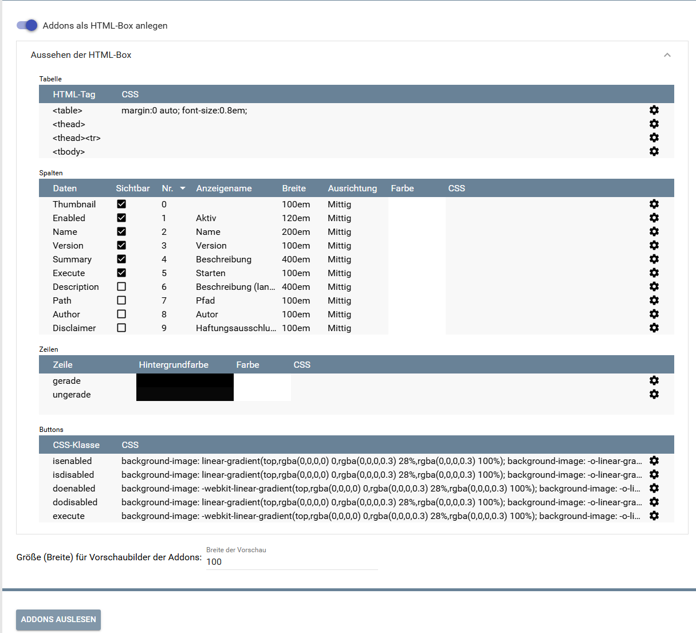
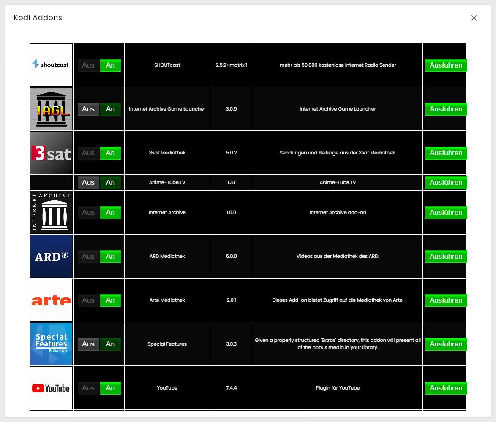
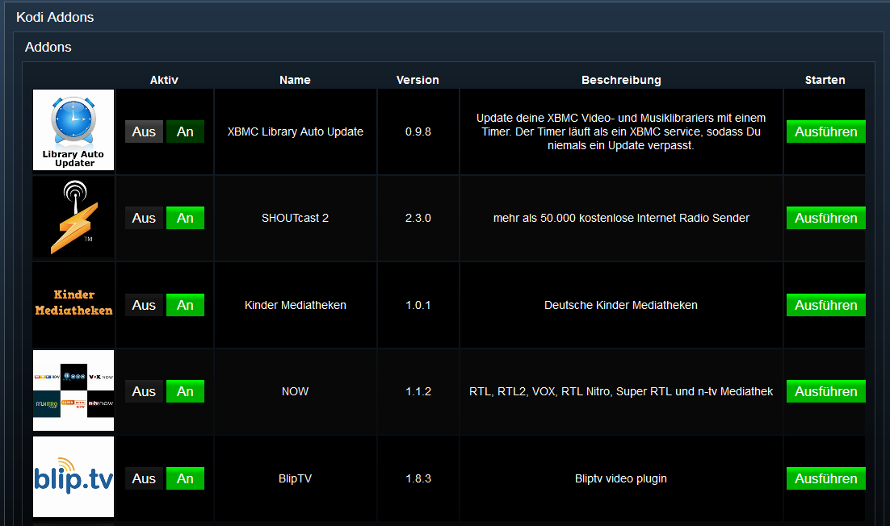

[](https://www.symcon.de/service/dokumentation/entwicklerbereich/sdk-tools/sdk-php/)
[](https://community.symcon.de/t/modul-kodi/41646)
[](https://www.symcon.de/de/service/dokumentation/installation/migrationen/v80-v81-q3-2025/)  
[](#10-lizenz)
[](https://github.com/Nall-chan/Kodi/actions)
[](https://github.com/Nall-chan/Kodi/actions)  
[](#2-spenden)
[](#2-spenden)
# Kodi Addons (KodiDeviceAddons)  <!-- omit in toc -->

Ermöglicht das Verwalten, Ausführen und Darstellen von Kodi-Addons in IP-Symcon.

## Inhaltsverzeichnis  <!-- omit in toc -->

- [1. Funktionsumfang](#1-funktionsumfang)
- [2. Voraussetzungen](#2-voraussetzungen)
- [3. Software-Installation](#3-software-installation)
- [4. Einrichten der Instanzen in IP-Symcon](#4-einrichten-der-instanzen-in-ip-symcon)
- [5. Statusvariablen](#5-statusvariablen)
- [6. Visualisierung](#6-visualisierung)
  - [Kachel Visualisierung](#kachel-visualisierung)
  - [WebFront Visualisierung](#webfront-visualisierung)
- [7. PHP-Befehlsreferenz](#7-php-befehlsreferenz)
- [8. Aktionen](#8-aktionen)
- [9. Anhang](#9-anhang)
  - [1. Changelog](#1-changelog)
  - [2. Spenden](#2-spenden)
- [10. Lizenz](#10-lizenz)

## 1. Funktionsumfang

- Verwaltung von Kodi-Addons (Anzeige, Aktivierung/Deaktivierung).
- Ausführen von Addons mit optionalen Parametern.
- Visualisierung der Addon-Liste im WebFront und in der Kachel-Visualisierung.

## 2. Voraussetzungen

- Symcon ab Version 9.0
- Verbundener [Kodi-Splitter](../KodiSplitter/README.md)

## 3. Software-Installation

Dieses Modul ist Bestandteil der [Kodi-Library](../README.md#3-software-installation).

## 4. Einrichten der Instanzen in IP-Symcon

Eine einfache Einrichtung ist über den Konfigurator [Kodi Konfigurator](../KodiConfigurator/README.md) möglich.  
Bei der manuellen Einrichtung ist die Instanz im Dialog `Instanz hinzufügen` unter dem Hersteller `Kodi` zu finden.  

  

**Konfigurationsseite:**



| Eigenschaft           | Name                          |   Typ   | Standardwert | Beschreibung                         |
| :-------------------- | :---------------------------- | :-----: | :----------: | :----------------------------------- |
| Zeige Addonliste      | showAddonlist                 | boolean |     true     | HTML-Tabelle mit den Addons erzeugen |
| Aussehen der HTML-Box | Table, Columns, Rows, Buttons | string  | siehe unten  | Design der HTML-Tabelle              |
| Thumbnail Größe       | ThumbSize                     | integer |     100      | Breite der Thumbnails in Pixeln      |

**Aussehen der HTML-Box:**

Spalten, Farben und CSS der Addon-Tabelle werden in vier Listen eingestellt. Die Listen liegen im Formular unter „Aussehen der HTML-Box“ und sind nur sichtbar, wenn die HTML-Box aktiviert ist.

| Liste   | Inhalt                                                                                                                                                      |
| :------ | :---------------------------------------------------------------------------------------------------------------------------------------------------------- |
| Tabelle | CSS für die Tags `<table>`, `<thead>`, die Kopfzeile (`<thead><tr>`) und `<tbody>`                                                                          |
| Spalten | Je Datenfeld: sichtbar, Position, Überschrift, Breite (em), Ausrichtung, Textfarbe der Überschrift und zusätzliches CSS für Überschrift und Zellen          |
| Zeilen  | Hintergrundfarbe, Textfarbe und zusätzliches CSS für gerade und ungerade Zeilen                                                                             |
| Buttons | CSS der Klassen für die Schaltflächen in der Tabelle: `isenabled`/`isdisabled` (Zustand), `doenabled`/`dodisabled` (schalten) und `execute` (Addon starten) |

Die Eigenschaften `Table`, `Columns`, `Rows` und `Buttons` sind JSON-Strings (Arrays der Listeneinträge) und können per `IPS_SetProperty` gesetzt werden. Einfacher ist das Bearbeiten im Formular.

> [!NOTE]
> Bis Version 3.02 wurde das Aussehen über ein verstecktes Konfigurations-Skript unterhalb der Instanz eingestellt. Beim Update wird dessen Inhalt einmalig in die Listen übernommen. Das Skript wird danach nicht mehr benutzt und kann gelöscht werden.

## 5. Statusvariablen

Folgende Statusvariablen werden automatisch angelegt. Je nach Konfiguration der Instanz werden einzelne Variablen nicht angelegt.

| Name   | Ident     |  Typ   | Beschreibung                                                        |
| :----- | :-------- | :----: | :------------------------------------------------------------------ |
| Addons | Addonlist | string | HTML-Box mit der Liste der installierten Addons (Profil `~HTMLBox`) |

## 6. Visualisierung

### Kachel Visualisierung

  

### WebFront Visualisierung



## 7. PHP-Befehlsreferenz

Für alle Befehle gilt:  
Tritt ein Fehler auf, wird eine Warnung erzeugt.

```php
bool KODIADDONS_ExecuteAddon(integer $InstanzID, string $AddonId);
```

Startet das in `$AddonId` übergebene Addon.  
Liefert `true` bei Erfolg, sonst `false`.

---

```php
bool KODIADDONS_ExecuteAddonWait(integer $InstanzID, string $AddonId);
```

Startet das in `$AddonId` übergebene Addon und wartet auf die Ausführung.  
Liefert `true` bei Erfolg, sonst `false`.

---

```php
bool KODIADDONS_ExecuteAddonEx(integer $InstanzID, string $AddonId, string $Param);
```

Startet das in `$AddonId` übergebene Addon mit Parametern.  
Die zu übergebenden Parameter an das Addon müssen als JSON-String in `$Param` übergeben werden.  
Liefert `true` bei Erfolg, sonst `false`.

---

```php
bool KODIADDONS_ExecuteAddonExWait(integer $InstanzID, string $AddonId, string $Param);
```

Startet das in `$AddonId` übergebene Addon mit Parametern und wartet auf die Ausführung.  
Liefert `true` bei Erfolg, sonst `false`.

---

```php
array|bool KODIADDONS_GetAddonDetails(integer $InstanzID, string $AddonId);
```

Liest die Eigenschaften eines Addons aus.  
Liefert ein assoziatives Array bei Erfolg, sonst `false`.

| Index        |  Typ   | Beschreibung                        |
| :----------- | :----: | :---------------------------------- |
| addonid      | string | Eindeutige ID des Addons            |
| disclaimer   | string | Haftungsausschluss                  |
| fanart       | string | Pfad zum Fanart                     |
| broken       | mixed  | Status, ob das Addon fehlerhaft ist |
| author       | string | Autor des Addons                    |
| enabled      |  bool  | Status, ob das Addon aktiviert ist  |
| extrainfo    | array  | Zusatzinformationen                 |
| thumbnail    | string | Pfad zum Cover/Thumbnail            |
| path         | string | Dateipfad                           |
| dependencies | array  | Abhängigkeiten                      |
| type         | array  | Addon-Typ                           |
| description  | string | Beschreibung                        |
| name         | string | Name des Addons                     |
| version      | string | Version des Addons                  |
| summary      | string | Zusammenfassung                     |
| rating       |  int   | Bewertung                           |

---

```php
array|bool KODIADDONS_GetAddons(integer $InstanzID);
```

Liest die Eigenschaften aller Addons aus.  
Liefert ein Array aller Addons bei Erfolg, sonst `false`.

---

```php
bool KODIADDONS_SetAddonEnabled(integer $InstanzID, string $AddonId, bool $Value);
```

De-/Aktiviert ein Addon.  
Liefert `true` bei Erfolg, sonst `false`.

---

```php
bool KODIADDONS_RequestState(integer $InstanzID, string $Ident);
```

Frage eine oder mehrere Properties eines Namespace ab.  

- `$Ident`: Enthält den Names des "properties" welches angefordert werden soll.

Rückgabe: true bei erfolgreicher Ausführung, sonst false.  

## 8. Aktionen

**Grundsätzlich können alle bedienbaren Statusvariablen als Ziel einer [`Aktion`](https://www.symcon.de/service/dokumentation/konzepte/automationen/ablaufplaene/aktionen/) mit `Auf Wert schalten` angesteuert werden, so dass hier keine speziellen Aktionen benutzt werden müssen.**

- Addons können direkt über die HTML-Tabelle ausgeführt werden
- Enable/Disable über Checkboxen in der Tabelle

## 9. Anhang

### 1. Changelog

[Changelog der Library](../README.md#2-changelog)

### 2. Spenden

Die Library ist für die nicht kommerzielle Nutzung kostenlos, Schenkungen als Unterstützung für den Autor werden hier akzeptiert:

PayPal:  
[](https://paypal.me/Nall4chan)

Wunschliste:  
[](https://www.amazon.de/hz/wishlist/ls/YU4AI9AQT9F?ref_=wl_share)

## 10. Lizenz

IPS-Modul:  
[Custom NC-SA](../LICENSE)