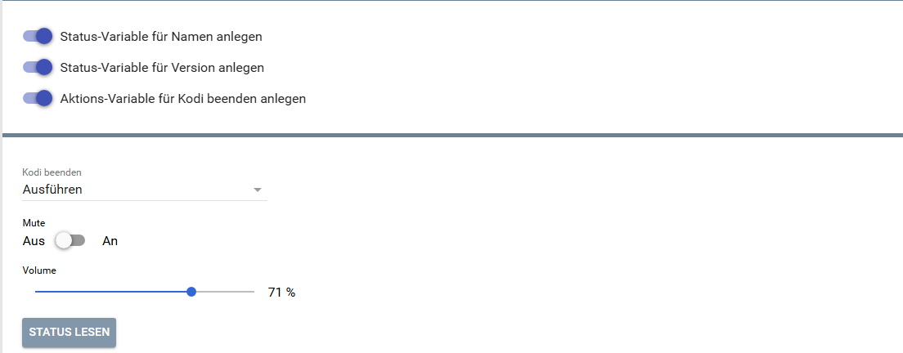
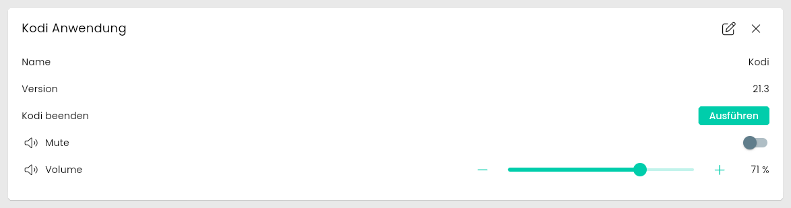
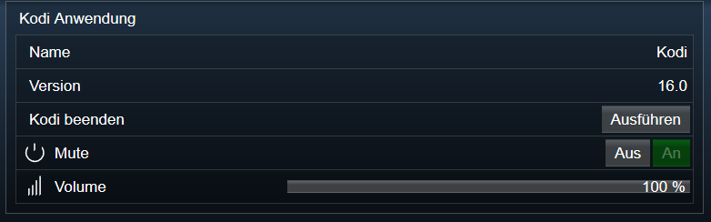

[](https://www.symcon.de/service/dokumentation/entwicklerbereich/sdk-tools/sdk-php/)
[](https://community.symcon.de/t/modul-kodi/41646)
[](https://www.symcon.de/de/service/dokumentation/installation/migrationen/v80-v81-q3-2025/)  
[](#10-lizenz)
[](https://github.com/Nall-chan/Kodi/actions)
[](https://github.com/Nall-chan/Kodi/actions)  
[](#2-spenden)
[](#2-spenden)
# Kodi Application (KodiDeviceApplication)  <!-- omit in toc -->

Ermöglicht die Steuerung sowie die Darstellung von Lautstärke, Stummschaltung und Anwendungsstatus von Kodi in IP-Symcon.

## Inhaltsverzeichnis  <!-- omit in toc -->

- [1. Funktionsumfang](#1-funktionsumfang)
- [2. Voraussetzungen](#2-voraussetzungen)
- [3. Software-Installation](#3-software-installation)
- [4. Einrichten der Instanzen in IP-Symcon](#4-einrichten-der-instanzen-in-ip-symcon)
- [5. Statusvariablen](#5-statusvariablen)
- [6. Visualisierung](#6-visualisierung)
  - [Kachel Visualisierung](#kachel-visualisierung)
  - [WebFront Visualisierung](#webfront-visualisierung)
- [7. PHP-Befehlsreferenz](#7-php-befehlsreferenz)
- [8. Aktionen](#8-aktionen)
- [9. Anhang](#9-anhang)
  - [1. Changelog](#1-changelog)
  - [2. Spenden](#2-spenden)
- [10. Lizenz](#10-lizenz)

## 1. Funktionsumfang

- Steuerung der Lautstärke (setzen/abfragen).
- Stummschaltung aktivieren/deaktivieren.
- Anzeige der Kodi-Version und Name.
- Beenden der Kodi-Anwendung.

## 2. Voraussetzungen

- Symcon ab Version 9.0
- Verbundener [Kodi-Splitter](../KodiSplitter/README.md)

## 3. Software-Installation

Dieses Modul ist Bestandteil der [Kodi-Library](../README.md#3-software-installation).

## 4. Einrichten der Instanzen in IP-Symcon

Eine einfache Einrichtung ist über den Konfigurator [Kodi Konfigurator](../KodiConfigurator/README.md) möglich.  
Bei der manuellen Einrichtung ist die Instanz im Dialog `Instanz hinzufügen` unter dem Hersteller `Kodi` zu finden.  

  

**Konfigurationsseite:**



| Eigenschaft   | Name        |   Typ   | Standardwert | Beschreibung                         |
| :------------ | :---------- | :-----: | :----------: | :----------------------------------- |
| Zeige Name    | showName    | boolean |     true     | Statusvariable für Name verwenden    |
| Zeige Version | showVersion | boolean |     true     | Statusvariable für Version verwenden |
| Zeige Beenden | showExit    | boolean |     true     | Aktions-Variable für Beenden anlegen |

Beispiel:

```php
IPS_SetProperty(12345, 'showName', false);
IPS_ApplyChanges(12345);
```

## 5. Statusvariablen

Folgende Statusvariablen werden automatisch angelegt. Je nach Konfiguration der Instanz werden einzelne Variablen nicht angelegt.

| Name         | Ident   |   Typ   | Beschreibung                              |
| :----------- | :------ | :-----: | :---------------------------------------- |
| Name         | name    | string  | Name der Kodi-Anwendung                   |
| Version      | version | string  | Version der Kodi-Anwendung                |
| Kodi beenden | quit    | integer | Schaltfläche: Kodi beenden                |
| Stumm        | mute    | boolean | Stummschaltung ein / aus (Profil `~Mute`) |
| Volume       | volume  | integer | Lautstärke 0 bis 100 (Profil `~Volume`)   |

## 6. Visualisierung

### Kachel Visualisierung

  

### WebFront Visualisierung



## 7. PHP-Befehlsreferenz

Für alle Befehle gilt:  
Tritt ein Fehler auf, wird eine Warnung erzeugt.

```php
bool KODIAPP_SetMute(integer $InstanzID, bool $Value);
```

De-/Aktiviert die Stummschaltung.  
Liefert `true` bei Erfolg, sonst `false`.

---

```php
bool KODIAPP_SetVolume(integer $InstanzID, integer $Value);
```

Setzt die Lautstärke (0 - 100).  
Liefert `true` bei Erfolg, sonst `false`.

---

```php
bool KODIAPP_Quit(integer $InstanzID);
```

Beendet die Kodi-Anwendung.  
Liefert `true` bei Erfolg, sonst `false`.

---

```php
bool KODIAPP_RequestState(integer $InstanzID, string $Ident);
```

Fordert den Wert einer Statusvariable an.  
Es ist der Ident der Statusvariable zu übergeben (`Volume`, `Mute`, `Name`, `Version`).  
Liefert `true` bei Erfolg, sonst `false`.

---

```php
bool KODIAPP_VolumeUp(integer $InstanzID);
```

Erhöht die Lautstärke um eine Stufe von Kodi.  

Rückgabe: true bei erfolgreicher Ausführung, sonst false.  

---

```php
bool KODIAPP_VolumeDown(integer $InstanzID);
```

Verringert die Lautstärke um eine Stufe von Kodi.  

Rückgabe: true bei erfolgreicher Ausführung, sonst false.  

---

```php
false|array KODIAPP_GetProfiles(integer $InstanzID);
```

Liefert alle Benutzerprofile von Kodi.  

Rückgabe: Array mit den Profilen (label, thumbnail, lockmode) oder false bei Fehler.  

---

```php
false|array KODIAPP_GetCurrentProfile(integer $InstanzID);
```

Liefert das aktive Benutzerprofil von Kodi.  

Rückgabe: Array mit dem Profil (label, thumbnail, lockmode) oder false bei Fehler.  

## 8. Aktionen

**Grundsätzlich können alle bedienbaren Statusvariablen als Ziel einer [`Aktion`](https://www.symcon.de/service/dokumentation/konzepte/automationen/ablaufplaene/aktionen/) mit `Auf Wert schalten` angesteuert werden, so dass hier keine speziellen Aktionen benutzt werden müssen.**

- Lautstärke über Slider anpassbar
- Stummschaltung über Checkbox
- Beenden über Button

## 9. Anhang

### 1. Changelog

[Changelog der Library](../README.md#2-changelog)

### 2. Spenden

Die Library ist für die nicht kommerzielle Nutzung kostenlos, Schenkungen als Unterstützung für den Autor werden hier akzeptiert:

PayPal:  
[](https://paypal.me/Nall4chan)

Wunschliste:  
[](https://www.amazon.de/hz/wishlist/ls/YU4AI9AQT9F?ref_=wl_share)

## 10. Lizenz

IPS-Modul:  
[Custom NC-SA](../LICENSE)