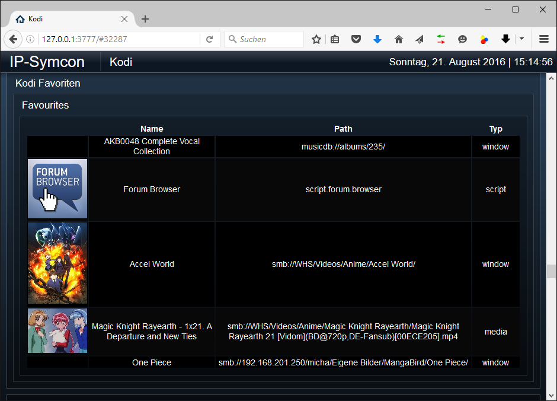

[](https://www.symcon.de/service/dokumentation/entwicklerbereich/sdk-tools/sdk-php/)
[](https://community.symcon.de/t/modul-kodi/41646)
[](https://www.symcon.de/de/service/dokumentation/installation/migrationen/v80-v81-q3-2025/)
[](#10-lizenz)
[](https://github.com/Nall-chan/Kodi/actions)
[](https://github.com/Nall-chan/Kodi/actions)
[](#2-spenden)
[](#2-spenden)

# Kodi Favoriten (KodiDeviceFavorites)  <!-- omit in toc -->

Ermöglicht das Auslesen, Ausführen und Darstellen von Kodi-Favoriten in IP-Symcon.

## Inhaltsverzeichnis  <!-- omit in toc -->

- [1. Funktionsumfang](#1-funktionsumfang)
- [2. Voraussetzungen](#2-voraussetzungen)
- [3. Software-Installation](#3-software-installation)
- [4. Einrichten der Instanzen in IP-Symcon](#4-einrichten-der-instanzen-in-ip-symcon)
- [5. Statusvariablen](#5-statusvariablen)
- [6. Visualisierung](#6-visualisierung)
  - [Kachel Visualisierung](#kachel-visualisierung)
  - [WebFront Visualisierung](#webfront-visualisierung)
- [7. PHP-Befehlsreferenz](#7-php-befehlsreferenz)
- [8. Aktionen](#8-aktionen)
- [9. Anhang](#9-anhang)
  - [1. Changelog](#1-changelog)
  - [2. Spenden](#2-spenden)
- [10. Lizenz](#10-lizenz)

## 1. Funktionsumfang

- Anzeige aller Kodi-Favoriten.
- Ausführen von Favoriten (Medien, Skripte, Fenster).
- Visualisierung der Favoritenliste im WebFront und in der Kachel-Visualisierung.

## 2. Voraussetzungen

- Symcon ab Version 9.0
- Funktionierender KodiSplitter
- Konfigurierte Verbindung zu einem Kodi-Gerät
- Eingerichtete Favoriten in Kodi

## 3. Software-Installation

Dieses Modul ist Bestandteil der [Kodi-Library](../README.md#3-software-installation).

## 4. Einrichten der Instanzen in IP-Symcon

Eine einfache Einrichtung ist über den Konfigurator [Kodi Konfigurator](../KodiConfigurator/README.md) möglich.  
Bei der manuellen Einrichtung ist die Instanz im Dialog `Instanz hinzufügen` unter dem Hersteller `Kodi` zu finden.

**Konfigurationsseite:**


| Name                 | Eigenschaft   |  Typ  | Standardwert | Funktion                                  |
| :------------------- | :------------ | :---: | :----------- | :---------------------------------------- |
| Zeige Favoritenliste | showFavlist   | bool  | true         | HTML-Tabelle mit den Favoriten erzeugen   |
| Aussehen der HTML-Box | Table, Columns, Rows | string | siehe unten | Design der HTML-Tabelle |
| Thumbnail Größe      | ThumbSize     |  int  | 100          | Breite der Thumbnails in Pixeln           |

**Aussehen der HTML-Box:**

Spalten, Farben und CSS der Favoriten-Tabelle werden in drei Listen eingestellt. Die Listen liegen im Formular unter „Aussehen der HTML-Box“ und sind nur sichtbar, wenn die HTML-Box aktiviert ist.

| Liste | Inhalt |
| :--- | :--- |
| Tabelle | CSS für die Tags `<table>`, `<thead>`, die Kopfzeile (`<thead><tr>`) und `<tbody>` |
| Spalten | Je Datenfeld: sichtbar, Position, Überschrift, Breite (em), Ausrichtung, Textfarbe der Überschrift und zusätzliches CSS für Überschrift und Zellen |
| Zeilen | Hintergrundfarbe, Textfarbe und zusätzliches CSS für gerade und ungerade Zeilen |

Die Eigenschaften `Table`, `Columns` und `Rows` sind JSON-Strings (Arrays der Listeneinträge) und können per `IPS_SetProperty` gesetzt werden. Einfacher ist das Bearbeiten im Formular.

> [!NOTE]
> Bis Version 3.02 wurde das Aussehen über ein verstecktes Konfigurations-Skript unterhalb der Instanz eingestellt. Beim Update wird dessen Inhalt einmalig in die Listen übernommen. Das Skript wird danach nicht mehr benutzt und kann gelöscht werden.

## 5. Statusvariablen

Folgende Statusvariablen werden automatisch angelegt.

| Name            |  Typ   | Ident     | Beschreibung                              |
| :-------------- | :----: | :-------- | :---------------------------------------- |
| Favoriten-Liste | string | Favorites | HTML-Box mit der Liste der Kodi-Favoriten |

## 6. Visualisierung

### Kachel Visualisierung

*Keine Kachel-Visualisierung vorhanden.*

### WebFront Visualisierung



## 7. PHP-Befehlsreferenz

Für alle Befehle gilt:  
Tritt ein Fehler auf, wird eine Warnung erzeugt.

```php
array|bool KODIFAV_GetFavorites(int $InstanzID, string $Type)
```

Liest die Eigenschaften der Favoriten aus, welche dem übergebenen Typ entsprechen (`all`, `media`, `window`, `script` oder `unknown`).  
Liefert ein assoziatives Array bei Erfolg, sonst `false`.

| Index           |  Typ   | Beschreibung                        |
| :-------------- | :----: | :---------------------------------- |
| thumbnail       | string | Pfad zum Cover                      |
| title           | string | Titel des Favoriten                 |
| type            | string | Typ des Favoriten                   |
| window          | string | Ziel-Fenster eines Window-Favoriten |
| windowparameter | string | Parameter für das Ziel-Fenster      |
| path            | string | Pfad zum Favoriten (Script & Media) |

---

```php
bool KODIFAV_LoadFavoriteMedia(int $InstanzID, string $Path)
```

Lädt einen Favoriten vom Typ Media.  
Liefert `true` bei Erfolg, sonst `false`.

---

```php
bool KODIFAV_LoadFavoriteScript(int $InstanzID, string $Script)
```

Lädt einen Favoriten vom Typ Script.  
Liefert `true` bei Erfolg, sonst `false`.

---

```php
bool KODIFAV_LoadFavoriteWindow(int $InstanzID, string $Window, string $WindowParameter)
```

Lädt einen Favoriten vom Typ Window.  
Liefert `true` bei Erfolg, sonst `false`.

> [!WARNING]
> Die Funktionen `KODIFAV_LoadFavouriteMedia`, `KODIFAV_LoadFavouriteScript`, `KODIFAV_LoadFavouriteWindow`, `KODIFAV_GetFavourites` und `KODIFAV_RefreshFavouriteList` (Schreibweise „Favourite“) sind veraltet. Sie funktionieren bis Version 3.20 weiter, schreiben aber bei jedem Aufruf eine Warnung ins Log.

## 8. Aktionen

**Grundsätzlich können alle bedienbaren Statusvariablen als Ziel einer [`Aktion`](https://www.symcon.de/service/dokumentation/konzepte/automationen/ablaufplaene/aktionen/) mit `Auf Wert schalten` angesteuert werden, so dass hier keine speziellen Aktionen benutzt werden müssen.**

- Favoriten können direkt über die HTML-Tabelle ausgeführt werden

## 9. Anhang

### 1. Changelog

[Changelog der Library](../README.md#2-changelog)

### 2. Spenden

Die Library ist für die nicht kommerzielle Nutzung kostenlos, Schenkungen als Unterstützung für den Autor werden hier akzeptiert:

PayPal:  
[](https://paypal.me/Nall4chan)

Wunschliste:  
[](https://www.amazon.de/hz/wishlist/ls/YU4AI9AQT9F?ref_=wl_share)

## 10. Lizenz

IPS-Modul:  
[Custom NC-SA](../LICENSE)