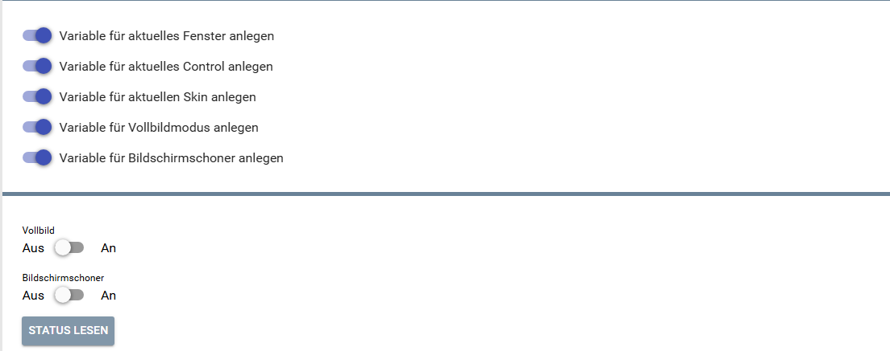
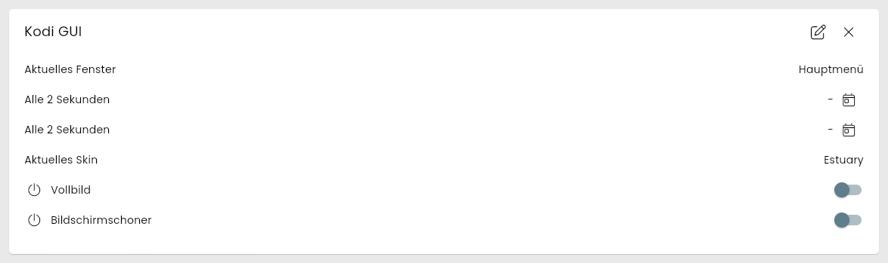
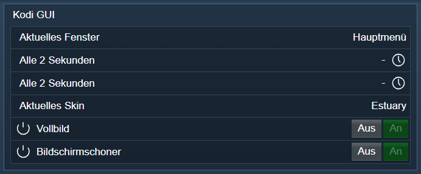

[](https://www.symcon.de/service/dokumentation/entwicklerbereich/sdk-tools/sdk-php/)
[](https://community.symcon.de/t/modul-kodi/41646)
[](https://www.symcon.de/de/service/dokumentation/installation/migrationen/v80-v81-q3-2025/)  
[](#10-lizenz)
[](https://github.com/Nall-chan/Kodi/actions)
[](https://github.com/Nall-chan/Kodi/actions)  
[](#2-spenden)
[](#2-spenden)
# Kodi GUI (KodiDeviceGUI)  <!-- omit in toc -->

Ermöglicht die Steuerung sowie die Darstellung der Benutzeroberfläche (GUI) von Kodi in IP-Symcon.

## Inhaltsverzeichnis  <!-- omit in toc -->

- [1. Funktionsumfang](#1-funktionsumfang)
- [2. Voraussetzungen](#2-voraussetzungen)
- [3. Software-Installation](#3-software-installation)
- [4. Einrichten der Instanzen in IP-Symcon](#4-einrichten-der-instanzen-in-ip-symcon)
- [5. Statusvariablen](#5-statusvariablen)
- [6. Visualisierung](#6-visualisierung)
  - [Kachel Visualisierung](#kachel-visualisierung)
  - [WebFront Visualisierung](#webfront-visualisierung)
- [7. PHP-Befehlsreferenz](#7-php-befehlsreferenz)
- [8. Aktionen](#8-aktionen)
- [9. Anhang](#9-anhang)
  - [1. Changelog](#1-changelog)
  - [2. Spenden](#2-spenden)
- [10. Lizenz](#10-lizenz)

## 1. Funktionsumfang

- Anzeige und Steuerung des aktuellen Kodi-Fensters.
- Umschalten von Vollbildmodus und Fensterwechsel.
- Anzeige des aktuellen Skins.
- Statusüberwachung des Bildschirmschoners.
- Versenden von Benachrichtigungen an den Bildschirm.

## 2. Voraussetzungen

- Symcon ab Version 9.0
- Verbundener [Kodi-Splitter](../KodiSplitter/README.md)

## 3. Software-Installation

Dieses Modul ist Bestandteil der [Kodi-Library](../README.md#3-software-installation).

## 4. Einrichten der Instanzen in IP-Symcon

Eine einfache Einrichtung ist über den Konfigurator [Kodi Konfigurator](../KodiConfigurator/README.md) möglich.  
Bei der manuellen Einrichtung ist die Instanz im Dialog `Instanz hinzufügen` unter dem Hersteller `Kodi` zu finden.  

  

**Konfigurationsseite:**



| Eigenschaft              | Name               |   Typ   | Standardwert | Beschreibung                                    |
| :----------------------- | :----------------- | :-----: | :----------: | :---------------------------------------------- |
| Zeige Aktuelles Fenster  | showCurrentWindow  | boolean |     true     | Statusvariable für aktuelles Fenster verwenden  |
| Zeige Aktuelle Steuerung | showCurrentControl | boolean |     true     | Statusvariable für aktuelle Steuerung verwenden |
| Zeige Skin               | showSkin           | boolean |     true     | Statusvariable für Skin verwenden               |
| Zeige Vollbildmodus      | showFullscreen     | boolean |     true     | Statusvariable für Vollbildmodus verwenden      |
| Zeige Bildschirmschoner  | showScreensaver    | boolean |     true     | Statusvariable für Bildschirmschoner verwenden  |

Beispiel:

```php
IPS_SetProperty(12345, 'showCurrentWindow', false);
IPS_ApplyChanges(12345);
```

## 5. Statusvariablen

Folgende Statusvariablen werden automatisch angelegt. Je nach Konfiguration der Instanz werden einzelne Variablen nicht angelegt.

| Name                   | Ident            |   Typ   | Beschreibung                                |
| :--------------------- | :--------------- | :-----: | :------------------------------------------ |
| Aktuelles Fenster      | currentwindow    | string  | Name des aktuell geöffneten Fensters        |
| Aktuelles Fenster (id) | _currentwindowid | integer | ID des aktuellen Fensters (ausgeblendet)    |
| Aktuelles Control      | currentcontrol   | string  | Aktuell fokussiertes Element (ausgeblendet) |
| Aktuelles Skin         | skin             | string  | Name des aktiven Skins                      |
| Aktuelles Skin (id)    | _skinid          | string  | ID des aktiven Skins (ausgeblendet)         |
| Vollbild               | fullscreen       | boolean | Vollbild ein / aus                          |
| Bildschirmschoner      | screensaver      | boolean | Bildschirmschoner ein / aus                 |

## 6. Visualisierung

### Kachel Visualisierung

  

### WebFront Visualisierung



## 7. PHP-Befehlsreferenz

Für alle Befehle gilt:  
Tritt ein Fehler auf, wird eine Warnung erzeugt.

```php
bool KODIGUI_SetFullscreen(integer $InstanzID, bool $Value);
```

De-/Aktiviert den Vollbildmodus.  
Liefert `true` bei Erfolg, sonst `false`.

---

```php
bool KODIGUI_ShowNotification(integer $InstanzID, string $Title, string $Message, string $Image, integer $Timeout);
```

Erzeugt eine Benachrichtigung auf dem Kodi-Bildschirm.  
Liefert `true` bei Erfolg, sonst `false`.

---

```php
bool KODIGUI_ActivateWindow(integer $InstanzID, string $Window);
```

Aktiviert ein bestimmtes Fenster in Kodi.  
Liefert `true` bei Erfolg, sonst `false`.

---

```php
bool KODIGUI_RequestState(integer $InstanzID, string $Ident);
```

Fordert den Wert einer Statusvariable an.  
Es ist der Ident der Statusvariable zu übergeben (`CurrentWindow`, `CurrentControl`, `Skin`, `Fullscreen`).  
Liefert `true` bei Erfolg, sonst `false`.

---

```php
bool KODIGUI_ActivateScreenSaver(integer $InstanzID);
```

Startet den Bildschirmschoner von Kodi.  

Rückgabe: true bei erfolgreicher Ausführung, sonst false.  

---

```php
bool KODIGUI_DeactivateScreenSaver(integer $InstanzID);
```

Beendet den Bildschirmschoner von Kodi. Kodi kennt dafür keine eigene Methode,  
jede Eingabe beendet ihn. Gesendet wird die Eingabeaktion 'noop', welche sonst nichts auslöst.  

Rückgabe: true bei erfolgreicher Ausführung, sonst false.  

---

```php
bool KODIGUI_ActivateWindowEx(integer $InstanzID, string $Window, string $Parameter);
```

Aktiviert ein Fenster mit einem Parameter (z.B. einem Pfad oder einer Datenbank-URL wie musicdb://albums/).  

- `$Window`: Das zu aktivierende Fenster
- `$Parameter`: Der Parameter für das Fenster

Rückgabe: true bei Erfolg, sonst false.  

---

```php
false|array KODIGUI_GetInfoLabels(integer $InstanzID, array $Labels);
```

Liest InfoLabels von Kodi aus (z.B. 'System.BuildVersion', 'Player.Title', 'Weather.Temperature').  

- `$Labels`: Liste der InfoLabels.

Rückgabe: Array InfoLabel => Wert (String) oder false bei Fehler.  

---

```php
false|array KODIGUI_GetInfoBooleans(integer $InstanzID, array $Booleans);
```

Liest boolesche Bedingungen von Kodi aus (z.B. 'Player.Playing', 'System.ScreenSaverActive').  

- `$Booleans`: Liste der Bedingungen.

Rückgabe: Array Bedingung => Wert oder false bei Fehler.  

## 8. Aktionen

**Grundsätzlich können alle bedienbaren Statusvariablen als Ziel einer [`Aktion`](https://www.symcon.de/service/dokumentation/konzepte/automationen/ablaufplaene/aktionen/) mit `Auf Wert schalten` angesteuert werden, so dass hier keine speziellen Aktionen benutzt werden müssen.**

- Vollbildmodus über Checkbox
- Fensterwechsel über Auswahlmenü
- Benachrichtigungen versenden

## 9. Anhang

### 1. Changelog

[Changelog der Library](../README.md#2-changelog)

### 2. Spenden

Die Library ist für die nicht kommerzielle Nutzung kostenlos, Schenkungen als Unterstützung für den Autor werden hier akzeptiert:

PayPal:  
[](https://paypal.me/Nall4chan)

Wunschliste:  
[](https://www.amazon.de/hz/wishlist/ls/YU4AI9AQT9F?ref_=wl_share)

## 10. Lizenz

IPS-Modul:  
[Custom NC-SA](../LICENSE)