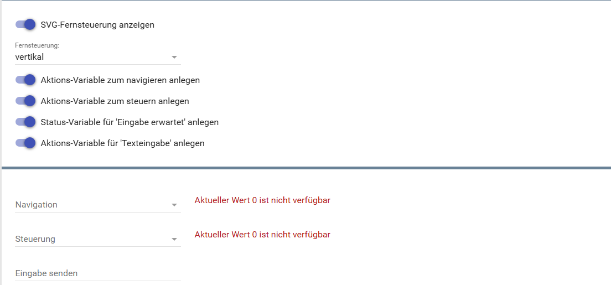
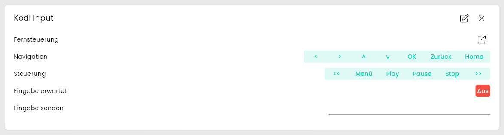
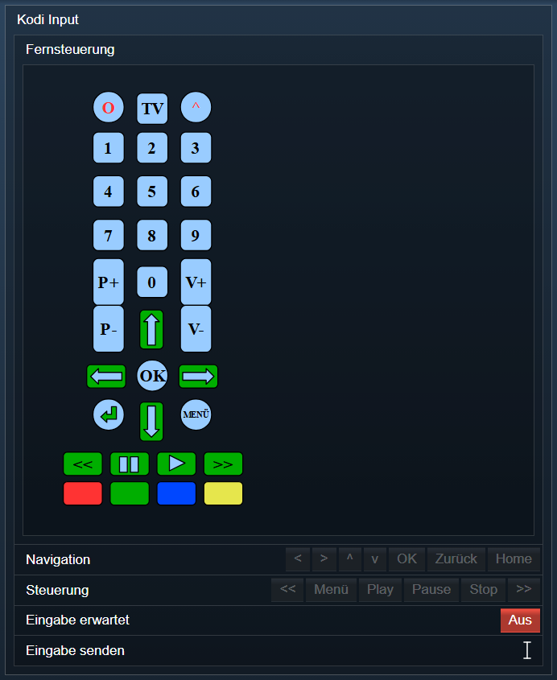

[](https://www.symcon.de/service/dokumentation/entwicklerbereich/sdk-tools/sdk-php/)
[](https://community.symcon.de/t/modul-kodi/41646)
[](https://www.symcon.de/de/service/dokumentation/installation/migrationen/v80-v81-q3-2025/)  
[](#10-lizenz)
[](https://github.com/Nall-chan/Kodi/actions)
[](https://github.com/Nall-chan/Kodi/actions)  
[](#2-spenden)
[](#2-spenden)
# Kodi Eingabesteuerung (KodiDeviceInput)  <!-- omit in toc -->

Ermöglicht das Senden von Tastendrücken, Aktionen und Texteingaben an Kodi in IP-Symcon.

## Inhaltsverzeichnis  <!-- omit in toc -->

- [1. Funktionsumfang](#1-funktionsumfang)
- [2. Voraussetzungen](#2-voraussetzungen)
- [3. Software-Installation](#3-software-installation)
- [4. Einrichten der Instanzen in IP-Symcon](#4-einrichten-der-instanzen-in-ip-symcon)
- [5. Statusvariablen](#5-statusvariablen)
- [6. Visualisierung](#6-visualisierung)
  - [Kachel Visualisierung](#kachel-visualisierung)
  - [WebFront Visualisierung](#webfront-visualisierung)
- [7. PHP-Befehlsreferenz](#7-php-befehlsreferenz)
- [8. Aktionen](#8-aktionen)
- [9. Anhang](#9-anhang)
  - [1. Changelog](#1-changelog)
  - [2. Spenden](#2-spenden)
- [10. Lizenz](#10-lizenz)

## 1. Funktionsumfang

- Senden von Navigations- und Steuerungstastendrücken an Kodi.
- Senden von Freitext-Eingaben an Kodi-Eingabefelder.
- Anzeige eines virtuellen Remote-Bedienfeldes.
- Erkennung, ob Kodi aktuell eine Eingabe erwartet.

## 2. Voraussetzungen

- Symcon ab Version 9.0
- Verbundener [Kodi-Splitter](../KodiSplitter/README.md)

## 3. Software-Installation

Dieses Modul ist Bestandteil der [Kodi-Library](../README.md#3-software-installation).

## 4. Einrichten der Instanzen in IP-Symcon

Eine einfache Einrichtung ist über den Konfigurator [Kodi Konfigurator](../KodiConfigurator/README.md) möglich.  
Bei der manuellen Einrichtung ist die Instanz im Dialog `Instanz hinzufügen` unter dem Hersteller `Kodi` zu finden.  

  

**Konfigurationsseite:**



| Eigenschaft               | Name                  |   Typ   | Standardwert | Beschreibung                                        |
| :------------------------ | :-------------------- | :-----: | :----------: | :-------------------------------------------------- |
| Zeige SVG Remote          | showSVGRemote         | boolean |     true     | SVG-Fernbedienung anzeigen                          |
| Remote-Layout             | RemoteId              | integer |      1       | 1 = vertikal, 2 = horizontal                        |
| Zeige Texteingabe         | showTextInput         | boolean |     true     | Aktionsvariable zum Senden von Text an Kodi anlegen |
| Zeige Navigationsbuttons  | showNavigationButtons | boolean |     true     | Navigationsschaltflächen anzeigen                   |
| Zeige Steuerungbuttons    | showControlButtons    | boolean |     true     | Steuerungsschaltflächen anzeigen                    |
| Zeige Eingabeaufforderung | showInputRequested    | boolean |     true     | Statusvariable bei ausstehender Eingabe anzeigen    |

Beispiel:

```php
IPS_SetProperty(12345, 'showSVGRemote', false);
IPS_ApplyChanges(12345);
```

## 5. Statusvariablen

Folgende Statusvariablen werden automatisch angelegt. Je nach Konfiguration der Instanz werden einzelne Variablen nicht angelegt.

| Name             | Ident          |   Typ   | Beschreibung                                           |
| :--------------- | :------------- | :-----: | :----------------------------------------------------- |
| Fernsteuerung    | Remote         | string  | HTML-Box mit der SVG-Fernbedienung (Profil `~HTMLBox`) |
| Navigation       | navremote      | integer | Navigationstasten (<, >, ^, v, OK, Zurück, Home)       |
| Steuerung        | ctrlremote     | integer | Medientasten (<<, Menü, Play, Pause, Stop, >>)         |
| Eingabe erwartet | inputrequested | boolean | Kodi wartet auf eine Texteingabe                       |
| Eingabe senden   | inputtext      | string  | Text zur Eingabe in Kodi senden                        |

## 6. Visualisierung

### Kachel Visualisierung

  

### WebFront Visualisierung



## 7. PHP-Befehlsreferenz

Für alle Befehle gilt:  
Tritt ein Fehler auf, wird eine Warnung erzeugt.

```php
bool KODIINPUT_Up(integer $InstanzID);
bool KODIINPUT_Down(integer $InstanzID);
bool KODIINPUT_Left(integer $InstanzID);
bool KODIINPUT_Right(integer $InstanzID);
```

Sendet Navigationsbefehle (hoch, runter, links, rechts).  
Liefert `true` bei Erfolg, sonst `false`.

---

```php
bool KODIINPUT_Select(integer $InstanzID);
bool KODIINPUT_ContextMenu(integer $InstanzID);
bool KODIINPUT_Home(integer $InstanzID);
bool KODIINPUT_Info(integer $InstanzID);
bool KODIINPUT_ShowOSD(integer $InstanzID);
bool KODIINPUT_ShowCodec(integer $InstanzID);
```

Sendet Steuerungsbefehle an Kodi.  
Liefert `true` bei Erfolg, sonst `false`.

---

```php
bool KODIINPUT_ExecuteAction(integer $InstanzID, string $Action);
```

Sendet die in `$Action` übergebene Kodi-Aktion (z. B. `back`, `fullscreen`, `playpause`).  
Liefert `true` bei Erfolg, sonst `false`.

---

```php
bool KODIINPUT_SendText(integer $InstanzID, string $Text, bool $Done);
```

Sendet den in `$Text` enthaltenen Text an Kodi. Mit `$Done = true` wird die Eingabe abgeschlossen.  
Liefert `true` bei Erfolg, sonst `false`.

---

```php
bool KODIINPUT_Back(integer $InstanzID);
```

Tastendruck 'Zurück' ausführen.  

Rückgabe: true bei erfolgreicher Ausführung, sonst false.  

---

```php
bool KODIINPUT_ShowPlayerProcessInfo(integer $InstanzID);
```

Zeigt die Informationen zur Wiedergabe (Decoder, Bildformat usw.) an.  

Rückgabe: true bei erfolgreicher Ausführung, sonst false.  

---

```php
bool KODIINPUT_ButtonEvent(integer $InstanzID, string $Button, string $Keymap, integer $HoldTime);
```

Simuliert einen Tastendruck einer Tastatur oder Fernbedienung.  
Ausgeführt wird die Funktion, welche in der Tastenbelegung (Keymap) von Kodi für die Taste hinterlegt ist.  

- `$Button`: Name der Taste aus der Keymap von Kodi (z.B. 'up', 'enter', 'escape', 'f1').
- `$Keymap`: Tastenbelegung: 'KB' (Tastatur), 'XG' (Xbox-Gamepad), 'R1' oder 'R2' (Fernbedienungen).
- `$HoldTime`: Dauer des Tastendrucks in Millisekunden (0 = kurzer Druck).

Rückgabe: true bei erfolgreicher Ausführung, sonst false.  

## 8. Aktionen

**Grundsätzlich können alle bedienbaren Statusvariablen als Ziel einer [`Aktion`](https://www.symcon.de/service/dokumentation/konzepte/automationen/ablaufplaene/aktionen/) mit `Auf Wert schalten` angesteuert werden, so dass hier keine speziellen Aktionen benutzt werden müssen.**

- Navigation über virtuelle Fernbedienung
- Texteingabe über WebFront-Dialog
- Direkte Ausführung von Aktionen

## 9. Anhang

### 1. Changelog

[Changelog der Library](../README.md#2-changelog)

### 2. Spenden

Die Library ist für die nicht kommerzielle Nutzung kostenlos, Schenkungen als Unterstützung für den Autor werden hier akzeptiert:

PayPal:  
[](https://paypal.me/Nall4chan)

Wunschliste:  
[](https://www.amazon.de/hz/wishlist/ls/YU4AI9AQT9F?ref_=wl_share)

## 10. Lizenz

IPS-Modul:  
[Custom NC-SA](../LICENSE)