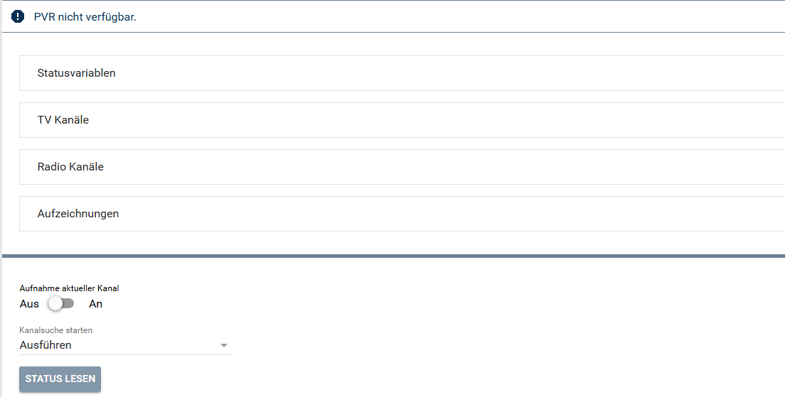
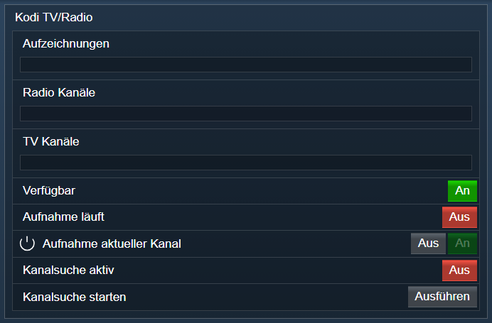

[](https://www.symcon.de/service/dokumentation/entwicklerbereich/sdk-tools/sdk-php/)
[](https://community.symcon.de/t/modul-kodi/41646)
[](https://www.symcon.de/de/service/dokumentation/installation/migrationen/v80-v81-q3-2025/)  
[](#10-lizenz)
[](https://github.com/Nall-chan/Kodi/actions)
[](https://github.com/Nall-chan/Kodi/actions)  
[](#2-spenden)
[](#2-spenden)
# Kodi PVR (KodiDevicePVR)  <!-- omit in toc -->

Ermöglicht das Verwalten, Steuern und Darstellen von Live-TV/Radio, Aufnahmen und Timern von Kodi in IP-Symcon.

## Inhaltsverzeichnis  <!-- omit in toc -->

- [1. Funktionsumfang](#1-funktionsumfang)
- [2. Voraussetzungen](#2-voraussetzungen)
- [3. Software-Installation](#3-software-installation)
- [4. Einrichten der Instanzen in IP-Symcon](#4-einrichten-der-instanzen-in-ip-symcon)
- [5. Statusvariablen](#5-statusvariablen)
- [6. Visualisierung](#6-visualisierung)
  - [Kachel Visualisierung](#kachel-visualisierung)
  - [WebFront Visualisierung](#webfront-visualisierung)
- [7. PHP-Befehlsreferenz](#7-php-befehlsreferenz)
- [8. Aktionen](#8-aktionen)
- [9. Anhang](#9-anhang)
  - [1. Changelog](#1-changelog)
  - [2. Spenden](#2-spenden)
- [10. Lizenz](#10-lizenz)

## 1. Funktionsumfang

- Verwaltung und Anzeige von TV- und Radio-Kanälen.
- Auslesen und Wiedergeben von Aufnahmen.
- Steuern und Überwachen von Aufnahmen und Timern.
- Kanalsuche / Scan ausführen.

## 2. Voraussetzungen

- Symcon ab Version 9.0
- Verbundener [Kodi-Splitter](../KodiSplitter/README.md)
- Aktiviertes PVR-Addon in Kodi

## 3. Software-Installation

Dieses Modul ist Bestandteil der [Kodi-Library](../README.md#3-software-installation).

## 4. Einrichten der Instanzen in IP-Symcon

Eine einfache Einrichtung ist über den Konfigurator [Kodi Konfigurator](../KodiConfigurator/README.md) möglich.  
Bei der manuellen Einrichtung ist die Instanz im Dialog `Instanz hinzufügen` unter dem Hersteller `Kodi` zu finden.  

  

**Konfigurationsseite:**



| Eigenschaft             | Name                                                                                                             |   Typ   | Standardwert | Beschreibung                                            |
| :---------------------- | :--------------------------------------------------------------------------------------------------------------- | :-----: | :----------: | :------------------------------------------------------ |
| Zeige PVR-Verfügbarkeit | showIsAvailable                                                                                                  | boolean |     true     | Statusvariable für Verfügbarkeit erzeugen               |
| Zeige Aufnahmestatus    | showIsRecording                                                                                                  | boolean |     true     | Statusvariable für aktive Aufnahme erzeugen             |
| Zeige Aufnahme-Aktion   | showDoRecording                                                                                                  | boolean |     true     | Aktionsvariable zur Aufnahmesteuerung erzeugen          |
| Zeige Suchlauf-Status   | showIsScanning                                                                                                   | boolean |     true     | Statusvariable für Kanalsuchlauf erzeugen               |
| Zeige Suchlauf-Aktion   | showDoScanning                                                                                                   | boolean |     true     | Aktionsvariable zum Starten des Kanalsuchlaufs erzeugen |
| Zeige TV-Kanalliste     | showTVChannellist                                                                                                | boolean |     true     | HTML-Tabelle mit TV-Kanälen erzeugen                    |
| Max. TV-Kanäle          | showMaxTVChannels                                                                                                | integer |      20      | Maximale Anzahl darzustellender TV-Kanäle               |
| Größe TV-Logos          | TVThumbSize                                                                                                      | integer |     100      | Größe der Senderlogos in der TV-Kanalliste in Pixeln    |
| Zeige Radio-Kanalliste  | showRadioChannellist                                                                                             | boolean |     true     | HTML-Tabelle mit Radio-Kanälen erzeugen                 |
| Max. Radio-Kanäle       | showMaxRadioChannels                                                                                             | integer |      20      | Maximale Anzahl darzustellender Radio-Kanäle            |
| Größe Radio-Logos       | RadioThumbSize                                                                                                   | integer |     100      | Größe der Senderlogos in der Radio-Kanalliste in Pixeln |
| Zeige Aufnahmeliste     | showRecordinglist                                                                                                | boolean |     true     | HTML-Tabelle mit Aufnahmen erzeugen                     |
| Max. Aufnahmen          | showMaxRecording                                                                                                 | integer |      20      | Maximale Anzahl darzustellender Aufnahmen               |
| Größe Aufnahme-Bilder   | RecordingThumbSize                                                                                               | integer |     100      | Größe der Bilder in der Aufnahmeliste in Pixeln         |
| Aussehen der HTML-Boxen | TVTable, TVColumns, TVRows, RadioTable, RadioColumns, RadioRows, RecordingTable, RecordingColumns, RecordingRows | string  | siehe unten  | Design der drei HTML-Tabellen                           |

**Aussehen der HTML-Box:**

Spalten, Farben und CSS werden für jede der drei Tabellen (TV, Radio, Aufnahmen) getrennt in drei Listen eingestellt. Die Listen liegen im Formular unter „Aussehen der HTML-Box“ und sind nur sichtbar, wenn die HTML-Box aktiviert ist.

| Liste   | Inhalt                                                                                                                                             |
| :------ | :------------------------------------------------------------------------------------------------------------------------------------------------- |
| Tabelle | CSS für die Tags `<table>`, `<thead>`, die Kopfzeile (`<thead><tr>`) und `<tbody>`                                                                 |
| Spalten | Je Datenfeld: sichtbar, Position, Überschrift, Breite (em), Ausrichtung, Textfarbe der Überschrift und zusätzliches CSS für Überschrift und Zellen |
| Zeilen  | Hintergrundfarbe, Textfarbe und zusätzliches CSS für gerade und ungerade Zeilen                                                                    |

Die Eigenschaften mit den Präfixen `TV`, `Radio` und `Recording` (z.B. `TVTable`, `TVColumns`, `TVRows`) sind JSON-Strings (Arrays der Listeneinträge) und können per `IPS_SetProperty` gesetzt werden. Einfacher ist das Bearbeiten im Formular.

> [!NOTE]
> Bis Version 3.02 wurde das Aussehen über ein verstecktes Konfigurations-Skript unterhalb der Instanz eingestellt. Beim Update wird dessen Inhalt einmalig in die Listen übernommen. Das Skript wird danach nicht mehr benutzt und kann gelöscht werden.

## 5. Statusvariablen

Folgende Statusvariablen werden automatisch angelegt. Je nach Konfiguration der Instanz werden einzelne Variablen nicht angelegt.

| Name                     | Ident            |   Typ   | Beschreibung                                    |
| :----------------------- | :--------------- | :-----: | :---------------------------------------------- |
| Verfügbar                | available        | boolean | Kodi meldet, dass PVR-Funktionen verfügbar sind |
| Aufnahme läuft           | recording        | boolean | Eine Aufnahme ist aktiv                         |
| Aufnahme aktueller Kanal | record           | boolean | Aufnahme des aktuellen Kanals starten / stoppen |
| Kanalsuche aktiv         | scanning         | boolean | Kanalsuchlauf läuft                             |
| Kanalsuche starten       | scan             | integer | Schaltfläche: Kanalsuchlauf starten             |
| TV Kanäle                | TVChannellist    | string  | HTML-Box mit den TV-Kanälen                     |
| Radio Kanäle             | RadioChannellist | string  | HTML-Box mit den Radio-Kanälen                  |
| Aufzeichnungen           | Recordinglist    | string  | HTML-Box mit den Aufzeichnungen                 |

## 6. Visualisierung

### Kachel Visualisierung

*Keine Kachel-Visualisierung vorhanden.*

### WebFront Visualisierung



## 7. PHP-Befehlsreferenz

Für alle Befehle gilt:  
Tritt ein Fehler auf, wird eine Warnung erzeugt.

```php
bool KODIPVR_Scan(integer $InstanzID);
```

Startet den PVR-Kanalsuchlauf.  
Liefert `true` bei Erfolg, sonst `false`.

---

```php
bool KODIPVR_Record(integer $InstanzID, bool $Record, string $Channel);
```

Startet (`$Record = true`) oder stoppt (`$Record = false`) eine Aufnahme auf dem angegebenen Kanal.  
Liefert `true` bei Erfolg, sonst `false`.

---

```php
array|bool KODIPVR_GetBroadcasts(integer $InstanzID, integer $ChannelId);
```

Liefert alle Sendungen eines Kanals als Array.  
Liefert ein Array bei Erfolg, sonst `false`.

---

```php
array|bool KODIPVR_GetChannels(integer $InstanzID, string $ChannelTyp);
```

Liest alle Kanäle vom Typ `$ChannelTyp` (`tv` oder `radio`) aus.  
Liefert ein Array bei Erfolg, sonst `false`.

---

```php
array|bool KODIPVR_GetRecordings(integer $InstanzID);
```

Liefert alle PVR-Aufnahmen als Array.  
Liefert ein Array bei Erfolg, sonst `false`.

---

```php
array|bool KODIPVR_GetTimers(integer $InstanzID);
```

Liefert alle programmierten Aufnahme-Timer als Array.  
Liefert ein Array bei Erfolg, sonst `false`.

---

```php
false|array KODIPVR_GetChannelDetails(integer $InstanzID, integer $ChannelId);
```

Liefert die Eigenschaften eines Kanals.  

- `$ChannelId`: Kanal welcher gelesen werden soll.

Rückgabe: Ein Array mit den Daten oder FALSE bei Fehler.  

---

```php
false|array KODIPVR_GetChannelGroups(integer $InstanzID, string $ChannelTyp);
```

Liest alle Kanalgruppen.  

- `$ChannelTyp`: [enum 'tv', 'radio'] Kanaltyp welcher gelesen werden soll.

Rückgabe: Ein Array mit den Daten oder FALSE bei Fehler.  

---

```php
false|array KODIPVR_GetChannelGroupDetails(integer $InstanzID, integer $ChannelGroupId);
```

Liefert die Eigenschaften einer Kanalgruppe.  

- `$ChannelGroupId`: Kanal welcher gelesen werden soll.

Rückgabe: Ein Array mit den Daten oder FALSE bei Fehler.  

---

```php
false|array KODIPVR_GetBroadcastDetails(integer $InstanzID, integer $BroadcastId);
```

Liefert die Eigenschaften einer Sendung.  

- `$BroadcastId`: Sendung welche gelesen werden soll.

Rückgabe: Ein Array mit den Daten oder FALSE bei Fehler.  

---

```php
false|array KODIPVR_GetRecordingDetails(integer $InstanzID, integer $RecordingId);
```

Liefert die Eigenschaften einer Aufnahme.  

- `$RecordingId`: Aufnahme welche gelesen werden soll.

Rückgabe: Ein Array mit den Daten oder FALSE bei Fehler.  

---

```php
bool KODIPVR_GetBroadcastIsPlayable(integer $InstanzID, integer $BroadcastId);
```

Prüft, ob eine Sendung abgespielt werden kann (läuft gerade oder ist als Catch-up verfügbar).  

- `$BroadcastId`: ID der Sendung (aus GetBroadcasts).

Rückgabe: True wenn abspielbar, false wenn nicht abspielbar oder bei Fehler.  

---

```php
false|array KODIPVR_GetClients(integer $InstanzID);
```

Liefert alle PVR-Clients (PVR-Addons) und deren Fähigkeiten.  

Rückgabe: Ein Array mit den Daten oder FALSE bei Fehler.  

---

```php
false|array KODIPVR_GetTimerDetails(integer $InstanzID, integer $TimerId);
```

Liefert die Eigenschaften einer AufnahmeTimers.  

- `$TimerId`: Timers welcher gelesen werden soll.

Rückgabe: Ein Array mit den Daten oder FALSE bei Fehler.  

---

```php
bool KODIPVR_AddTimer(integer $InstanzID, integer $BroadcastId, bool $TimerRule, bool $Reminder);
```

Legt einen Timer für eine Sendung an.  

- `$BroadcastId`: ID der Sendung (aus KODIPVR_GetBroadcasts).
- `$TimerRule`: true legt eine Timer-Regel (Serienaufnahme) an, false einen einmaligen Timer.
- `$Reminder`: true legt eine Erinnerung an, false eine Aufnahme.

Rückgabe: true bei Erfolg, sonst false.  

---

```php
bool KODIPVR_DeleteTimer(integer $InstanzID, integer $TimerId);
```

Löscht einen Timer oder eine Timer-Regel.  

- `$TimerId`: ID des Timers (aus KODIPVR_GetTimers).

Rückgabe: true bei Erfolg, sonst false.  

---

```php
bool KODIPVR_ToggleTimer(integer $InstanzID, integer $BroadcastId, bool $TimerRule);
```

Legt für eine Sendung einen Timer an oder löscht den vorhandenen.  

- `$BroadcastId`: ID der Sendung (aus KODIPVR_GetBroadcasts).
- `$TimerRule`: true für eine Timer-Regel (Serienaufnahme), false für einen einmaligen Timer.

Rückgabe: true bei Erfolg, sonst false.  

---

```php
void KODIPVR_RefreshAll(integer $InstanzID);
```

Erzeugt alle HTML-Tabellen neu  

---

```php
bool KODIPVR_RequestState(integer $InstanzID, string $Ident);
```

Frage eine oder mehrere Properties eines Namespace ab.  

- `$Ident`: Enthält den Names des 'properties' welches angefordert werden soll.

Rückgabe: true bei erfolgreicher Ausführung, sonst false.  

## 8. Aktionen

**Grundsätzlich können alle bedienbaren Statusvariablen als Ziel einer [`Aktion`](https://www.symcon.de/service/dokumentation/konzepte/automationen/ablaufplaene/aktionen/) mit `Auf Wert schalten` angesteuert werden, so dass hier keine speziellen Aktionen benutzt werden müssen.**

- Kanäle umschalten
- Aufnahmen starten/stoppen
- Timer verwalten

## 9. Anhang

### 1. Changelog

[Changelog der Library](../README.md#2-changelog)

### 2. Spenden

Die Library ist für die nicht kommerzielle Nutzung kostenlos, Schenkungen als Unterstützung für den Autor werden hier akzeptiert:

PayPal:  
[](https://paypal.me/Nall4chan)

Wunschliste:  
[](https://www.amazon.de/hz/wishlist/ls/YU4AI9AQT9F?ref_=wl_share)

## 10. Lizenz

IPS-Modul:  
[Custom NC-SA](../LICENSE)