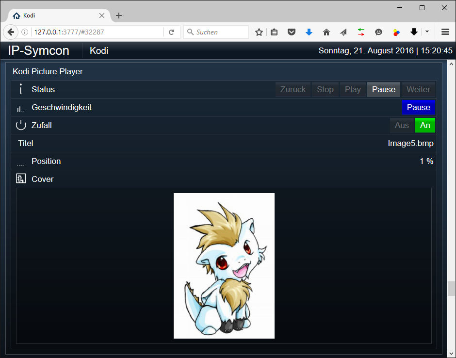

[](https://www.symcon.de/service/dokumentation/entwicklerbereich/sdk-tools/sdk-php/)
[](https://community.symcon.de/t/modul-kodi/41646)
[](https://www.symcon.de/de/service/dokumentation/installation/migrationen/v80-v81-q3-2025/)
[](#10-lizenz)
[](https://github.com/Nall-chan/Kodi/actions)
[](https://github.com/Nall-chan/Kodi/actions)
[](#2-spenden)
[](#2-spenden)

# Kodi Player (KodiDevicePlayer)  <!-- omit in toc -->

Ermöglicht die Steuerung der Wiedergabe sowie die Darstellung von Medieninhalten von Kodi in IP-Symcon.

## Inhaltsverzeichnis  <!-- omit in toc -->

- [1. Funktionsumfang](#1-funktionsumfang)
- [2. Voraussetzungen](#2-voraussetzungen)
- [3. Software-Installation](#3-software-installation)
- [4. Einrichten der Instanzen in IP-Symcon](#4-einrichten-der-instanzen-in-ip-symcon)
- [5. Statusvariablen](#5-statusvariablen)
- [6. Visualisierung](#6-visualisierung)
  - [Kachel Visualisierung](#kachel-visualisierung)
  - [WebFront Visualisierung](#webfront-visualisierung)
- [7. PHP-Befehlsreferenz](#7-php-befehlsreferenz)
- [8. Aktionen](#8-aktionen)
- [9. Anhang](#9-anhang)
  - [1. Changelog](#1-changelog)
  - [2. Spenden](#2-spenden)
- [10. Lizenz](#10-lizenz)

## 1. Funktionsumfang

- Steuerung der Wiedergabe (Play, Pause, Stop, Geschwindigkeit, Position).
- Navigation in Medien und Playlists.
- Anzeige des aktuellen Medieninhalts (Cover, Titel, Album, Interpret, Fortschritt).
- Steuerung von Untertiteln, Audiospuren und Wiedergabemodi (Repeat, Shuffle, Partymodus).

## 2. Voraussetzungen

- Symcon ab Version 9.0
- Funktionierender KodiSplitter
- Konfigurierte Verbindung zu einem Kodi-Gerät
- Konfigurierter Player-Typ (Audio, Video oder Bilder)

## 3. Software-Installation

Dieses Modul ist Bestandteil der [Kodi-Library](../README.md#3-software-installation).

## 4. Einrichten der Instanzen in IP-Symcon

Eine einfache Einrichtung ist über den Konfigurator [Kodi Konfigurator](../KodiConfigurator/README.md) möglich.  
Bei der manuellen Einrichtung ist die Instanz im Dialog `Instanz hinzufügen` unter dem Hersteller `Kodi` zu finden.

**Konfigurationsseite:**

  
  
  

| Name | Eigenschaft | Typ | Standardwert | Funktion |
| :--- | :--- | :---: | :--- | :--- |
| Player Typ | PlayerID | int | 0 | 0 = Audio, 1 = Video, 2 = Bilder |
| Cover-Skalierung | CoverSize | int | 300 | Höhe des Covers in Pixeln |
| Cover Typ | CoverTyp | string | thumb | Varianten: `thumb`, `album`, `artist`, `fanart`, `poster`, `banner` |

## 5. Statusvariablen

Folgende Statusvariablen werden automatisch angelegt.

| Name | Typ | Ident | Beschreibung |
| :--- | :---: | :--- | :--- |
| Status | int | Speed | Wiedergabestatus / Geschwindigkeit |
| Position | float | Position | Aktuelle Wiedergabeposition in Prozent |
| Zeit | int | Time | Aktuelle Wiedergabezeit in Sekunden |
| Gesamtlaufzeit | int | Duration | Gesamtlaufzeit des Titels in Sekunden |
| Wiederholung | int | Repeat | Wiederholungsmodus (0 = aus, 1 = Titel, 2 = Alle) |
| Zufall | bool | Shuffle | Zufallswiedergabe aktiv / inaktiv |
| Partymodus | bool | Partymode | Partymodus aktiv / inaktiv |
| Titel | string | Title | Titel des aktuellen Eintrags |
| Album | string | Album | Album des aktuellen Eintrags |
| Interpret | string | Artist | Interpret des aktuellen Eintrags |

## 6. Visualisierung

### Kachel Visualisierung

*Keine Kachel-Visualisierung vorhanden.*

### WebFront Visualisierung

  
  


## 7. PHP-Befehlsreferenz

Für alle Befehle gilt:  
Tritt ein Fehler auf, wird eine Warnung erzeugt.

```php
array|bool KODIPLAYER_GetItem(int $InstanzID)
```

Holt die Daten des aktuell wiedergegebenen Eintrags und gibt diese als assoziatives Array zurück.  
Liefert ein Array bei Erfolg, sonst `false`.

---

```php
bool KODIPLAYER_Play(int $InstanzID)
bool KODIPLAYER_Pause(int $InstanzID)
bool KODIPLAYER_Stop(int $InstanzID)
```

Steuert die Wiedergabe.  
Liefert `true` bei Erfolg, sonst `false`.

---

```php
bool KODIPLAYER_GoToNext(int $InstanzID)
bool KODIPLAYER_GoToPrevious(int $InstanzID)
bool KODIPLAYER_GoToTrack(int $InstanzID, int $Value)
```

Springt zum nächsten, vorherigen oder einem bestimmten Titel in der Playlist.  
Liefert `true` bei Erfolg, sonst `false`.

---

```php
bool KODIPLAYER_SetPosition(int $InstanzID, int $Value)
```

Springt auf eine absolute Position in Sekunden.  
Liefert `true` bei Erfolg, sonst `false`.

---

```php
bool KODIPLAYER_SetSpeed(int $InstanzID, int $Value)
```

Setzt die Abspielgeschwindigkeit (`-32`, `-16`, `-8`, `-4`, `-2`, `0`, `1`, `2`, `4`, `8`, `16`, `32`).  
Liefert `true` bei Erfolg, sonst `false`.

---

```php
bool KODIPLAYER_SetRepeat(int $InstanzID, int $Value)
```

Setzt den Wiederholungsmodus (`0` = aus, `1` = Titel, `2` = Alle).  
Liefert `true` bei Erfolg, sonst `false`.

---

```php
bool KODIPLAYER_SetShuffle(int $InstanzID, bool $Value)
```

De-/Aktiviert den Zufallsmodus.  
Liefert `true` bei Erfolg, sonst `false`.

---

```php
bool KODIPLAYER_SetPartymode(int $InstanzID, bool $Value)
```

De-/Aktiviert den Partymodus.  
Liefert `true` bei Erfolg, sonst `false`.

---

```php
bool KODIPLAYER_SetAudioStream(int $InstanzID, int $Value)
```

Aktiviert die Audiospur mit dem übergebenen Index.  
Liefert `true` bei Erfolg, sonst `false`.

---

```php
bool KODIPLAYER_SetSubtitle(int $InstanzID, int $Value)
```

Aktiviert den Untertitel mit dem übergebenen Index. `-1` deaktiviert den Untertitel.  
Liefert `true` bei Erfolg, sonst `false`.

## 8. Aktionen

**Grundsätzlich können alle bedienbaren Statusvariablen als Ziel einer [`Aktion`](https://www.symcon.de/service/dokumentation/konzepte/automationen/ablaufplaene/aktionen/) mit `Auf Wert schalten` angesteuert werden, so dass hier keine speziellen Aktionen benutzt werden müssen.**

- Wiedergabe steuern über Buttons
- Position in der Wiedergabe anpassen
- Audiospur und Untertitel auswählen

## 9. Anhang

### 1. Changelog

[Changelog der Library](../README.md#2-changelog)

### 2. Spenden

Die Library ist für die nicht kommerzielle Nutzung kostenlos, Schenkungen als Unterstützung für den Autor werden hier akzeptiert:

PayPal:  
[](https://paypal.me/Nall4chan)

Wunschliste:  
[](https://www.amazon.de/hz/wishlist/ls/YU4AI9AQT9F?ref_=wl_share)

## 10. Lizenz

IPS-Modul:  
[Custom NC-SA](../LICENSE)