[](https://www.symcon.de/service/dokumentation/entwicklerbereich/sdk-tools/sdk-php/)
[](https://community.symcon.de/t/modul-kodi/41646)
[](https://www.symcon.de/de/service/dokumentation/installation/migrationen/v80-v81-q3-2025/)  
[](#10-lizenz)
[](https://github.com/Nall-chan/Kodi/actions)
[](https://github.com/Nall-chan/Kodi/actions)  
[](#2-spenden)
[](#2-spenden)
# Kodi Player (KodiDevicePlayer)  <!-- omit in toc -->

Ermöglicht die Steuerung der Wiedergabe sowie die Darstellung von Medieninhalten von Kodi in IP-Symcon.

## Inhaltsverzeichnis  <!-- omit in toc -->

- [1. Funktionsumfang](#1-funktionsumfang)
- [2. Voraussetzungen](#2-voraussetzungen)
- [3. Software-Installation](#3-software-installation)
- [4. Einrichten der Instanzen in IP-Symcon](#4-einrichten-der-instanzen-in-ip-symcon)
- [5. Statusvariablen](#5-statusvariablen)
- [6. Visualisierung](#6-visualisierung)
  - [Kachel Visualisierung](#kachel-visualisierung)
  - [WebFront Visualisierung](#webfront-visualisierung)
- [7. PHP-Befehlsreferenz](#7-php-befehlsreferenz)
- [8. Aktionen](#8-aktionen)
- [9. Anhang](#9-anhang)
  - [1. Changelog](#1-changelog)
  - [2. Spenden](#2-spenden)
- [10. Lizenz](#10-lizenz)

## 1. Funktionsumfang

- Steuerung der Wiedergabe (Play, Pause, Stop, Geschwindigkeit, Position).
- Navigation in Medien und Playlists.
- Anzeige des aktuellen Medieninhalts (Cover, Titel, Album, Interpret, Fortschritt).
- Steuerung von Untertiteln, Audiospuren und Wiedergabemodi (Repeat, Shuffle, Partymodus).

## 2. Voraussetzungen

- Symcon ab Version 9.0
- Verbundener [Kodi-Splitter](../KodiSplitter/README.md)
- Konfigurierter Player-Typ (Audio, Video oder Bilder)

## 3. Software-Installation

Dieses Modul ist Bestandteil der [Kodi-Library](../README.md#3-software-installation).

## 4. Einrichten der Instanzen in IP-Symcon

Eine einfache Einrichtung ist über den Konfigurator [Kodi Konfigurator](../KodiConfigurator/README.md) möglich.  
Bei der manuellen Einrichtung ist die Instanz im Dialog `Instanz hinzufügen` unter dem Hersteller `Kodi` zu finden.  

  

**Konfigurationsseite:**

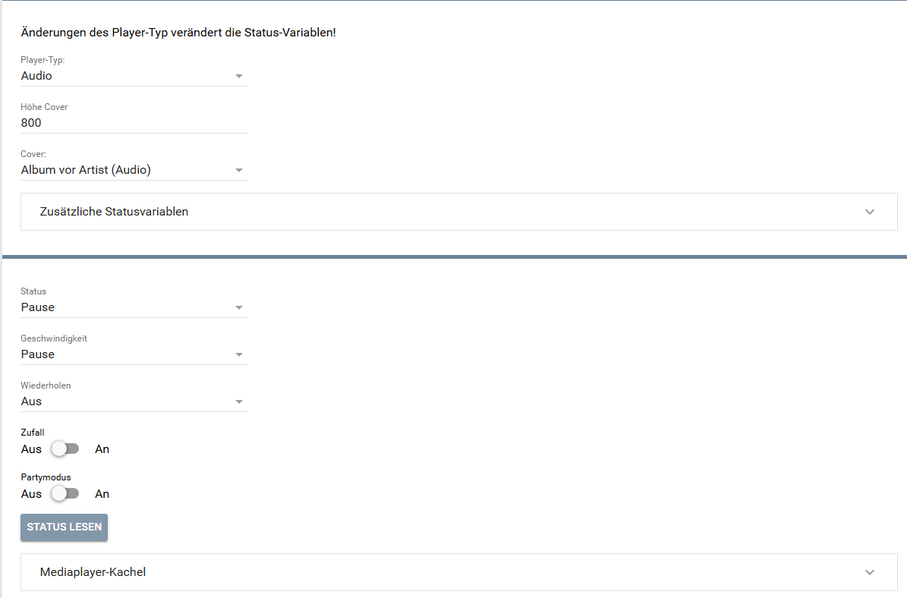  
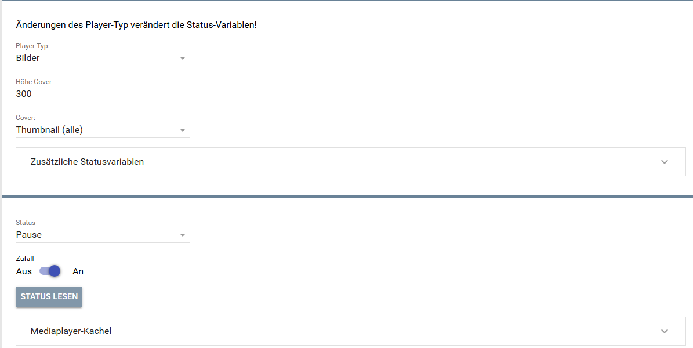  
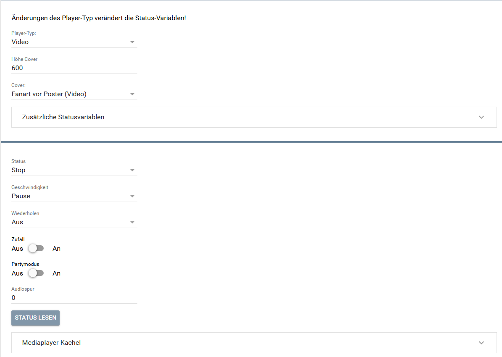  

| Eigenschaft                   | Name            |   Typ   | Standardwert | Beschreibung                                                                                                                                                                                                                                        |
| :---------------------------- | :-------------- | :-----: | :----------: | :-------------------------------------------------------------------------------------------------------------------------------------------------------------------------------------------------------------------------------------------------- |
| Player-Typ                    | PlayerID        | integer |      0       | `0` = Audio, `1` = Video, `2` = Bilder                                                                                                                                                                                                              |
| Höhe Cover                    | CoverSize       | integer |     300      | Höhe des Covers in Pixeln                                                                                                                                                                                                                           |
| Cover                         | CoverTyp        | string  |    thumb     | Bevorzugte Bildart: `thumb` (Vorschaubild, alle), `album` (Album vor Interpret, Audio), `artist` (Interpret vor Vorschaubild, Audio), `fanart` (Fanart vor Poster, Video), `poster` (Poster vor Banner, Video), `banner` (Banner vor Poster, Video) |
| Videospur (nur Video)         | showVideoStream | boolean |     true     | Legt die Variable `videostream` an                                                                                                                                                                                                                  |
| Audio-Verzögerung (nur Video) | showAudioDelay  | boolean |     true     | Legt die Variable `audiodelay` an                                                                                                                                                                                                                   |
| Bildformat (nur Video)        | showViewMode    | boolean |     true     | Legt die Variable `viewmode` an                                                                                                                                                                                                                     |
| Tempo (Audio und Video)       | showTempo       | boolean |     true     | Legt die Variable `tempo` an                                                                                                                                                                                                                        |

> [!WARNING]
> Ein Wechsel des Player-Typs löscht die Statusvariablen, die der neue Typ nicht benötigt.

Beispiel:

```php
IPS_SetProperty(12345, 'PlayerID', 1);
IPS_SetProperty(12345, 'showTempo', true);
IPS_ApplyChanges(12345);
```

Die Schaltflächen im Bereich `Mediaplayer-Kachel` des Formulars (Funktionen [KODIPLAYER_CreateTileLinks](#7-php-befehlsreferenz) und `KODIPLAYER_RemoveTileLinks`) legen Links auf die Lautstärke, die Stummschaltung (Instanz Kodi Application) und die Playlist unterhalb der Player-Instanz an bzw. entfernen sie wieder, damit die Mediaplayer-Kachel alle Elemente zeigt (siehe [Kachel Visualisierung](#kachel-visualisierung)).

## 5. Statusvariablen

Folgende Statusvariablen werden automatisch angelegt. Welche Variablen existieren, hängt vom Player-Typ ab.

| Name               | Ident       |     Typ      |    Player    | Beschreibung                                                                            |
| :----------------- | :---------- | :----------: | :----------: | :-------------------------------------------------------------------------------------- |
| Status             | Status      |   integer    |     alle     | Wiedergabe steuern (Zurück, Stopp, Pause, Play, Weiter), Profil `~PlaybackPreviousNext` |
| Geschwindigkeit    | speed       |   integer    |     alle     | Abspielgeschwindigkeit, bei Bildern nur Zurück/Pause/Vorwärts                           |
| Position           | percentage  |    float     |     alle     | Wiedergabeposition in Prozent, schaltbar                                                |
| Zufall             | shuffled    |   boolean    |     alle     | Zufallswiedergabe                                                                       |
| Titel              | label       |    string    |     alle     | Titel des aktuellen Eintrags                                                            |
| Wiederholen        | repeat      |   integer    | Audio, Video | Wiederholmodus, Profil `~Repeat`                                                        |
| Partymodus         | partymode   |   boolean    | Audio, Video | Partymodus                                                                              |
| Jahr               | year        |   integer    | Audio, Video | Erscheinungsjahr                                                                        |
| Genre              | genre       |    string    | Audio, Video | Genre                                                                                   |
| Dauer              | duration    |    string    | Audio, Video | Gesamtdauer als Text                                                                    |
| Spielzeit          | time        |    string    | Audio, Video | Aktuelle Spielzeit als Text                                                             |
| Tempo              | tempo       |    float     | Audio, Video | Wiedergabetempo 0,8 bis 1,5 (optional, Eigenschaft `showTempo`)                         |
| Album              | album       |    string    |    Audio     | Album                                                                                   |
| Track              | track       |   integer    |    Audio     | Titelnummer                                                                             |
| Disc               | disc        |   integer    |    Audio     | Datenträgernummer                                                                       |
| Artist             | artist      |    string    |    Audio     | Interpret                                                                               |
| Lyrics             | lyrics      |    string    |    Audio     | Liedtext                                                                                |
| Serie              | showtitle   |    string    |    Video     | Titel der Serie                                                                         |
| Kanal              | channel     |    string    |    Video     | Sender bei Live-TV                                                                      |
| Staffel            | season      |   integer    |    Video     | Staffel                                                                                 |
| Episode            | episode     |   integer    |    Video     | Folge                                                                                   |
| Handlung           | plot        |    string    |    Video     | Beschreibung                                                                            |
| Audiospur          | audiostream |   integer    |    Video     | Auswahl der Audiospur                                                                   |
| Aktiver Untertitel | subtitle    |   integer    |    Video     | Auswahl des Untertitels                                                                 |
| Videospur          | videostream |   integer    |    Video     | Auswahl der Videospur (optional, Eigenschaft `showVideoStream`)                         |
| Audio-Verzögerung  | audiodelay  |    float     |    Video     | Verzögerung des Tons in Sekunden (optional, Eigenschaft `showAudioDelay`)               |
| Bildformat         | viewmode    |   integer    |    Video     | Bildformat (optional, Eigenschaft `showViewMode`)                                       |
| Cover              | CoverIMG    | Medienobjekt |     alle     | Cover bzw. Vorschaubild des aktuellen Eintrags                                          |

> [!NOTE]
> Das Cover ist ein Medienobjekt, das die Instanz selbst anlegt (Größe und Bildart siehe Eigenschaften).

## 6. Visualisierung

### Kachel Visualisierung

Die Instanz wird in der Kachel-Visualisierung als Mediaplayer dargestellt, da sie die Variable `Status` mit dem Profil `~PlaybackPreviousNext` enthält.  
Zusätzlich nutzt die Mediaplayer-Kachel die Variablen `Position` (`~Progress`), `Wiederholen` (`~Repeat`), `Zufall` (`~Shuffle`), `Titel` (`~Song`) und beim Audio-Player `Artist` (`~Artist`).  

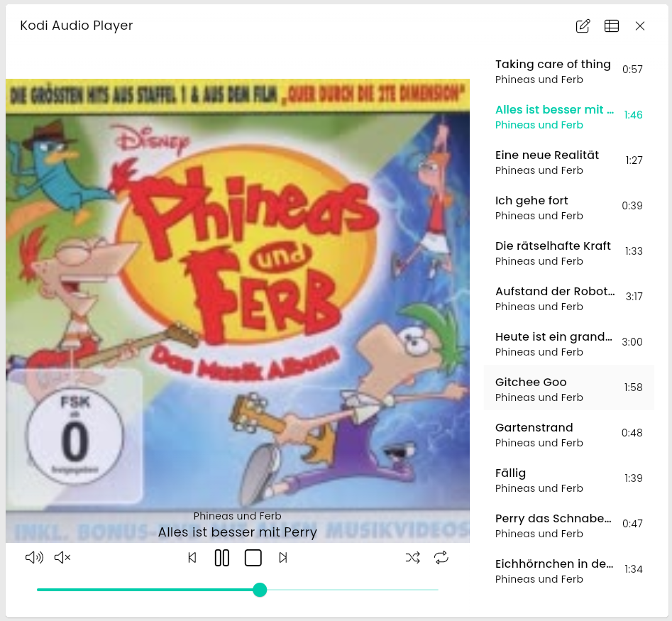  
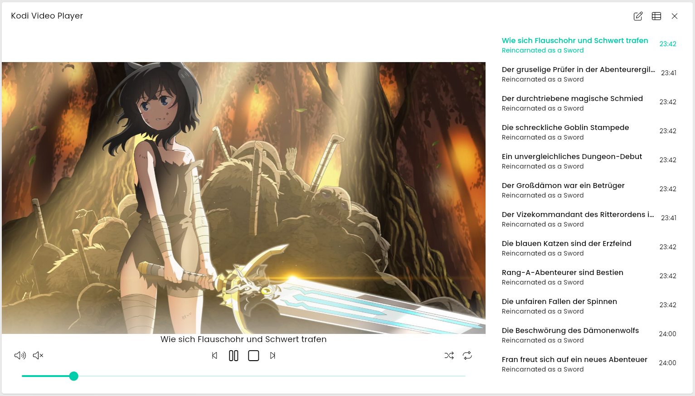  
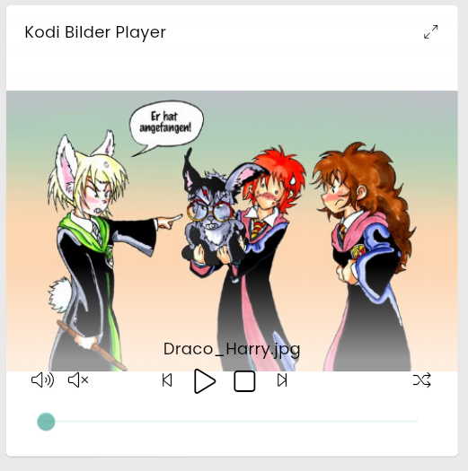  

Maximiert und in der Darstellung `Liste` zeigt die Kachel alle Variablen der Instanz, hier beim Audio-Player, Video-Player und beim Bilder-Player. Das Cover erscheint in der Liste nur als Symbol zum Öffnen.  

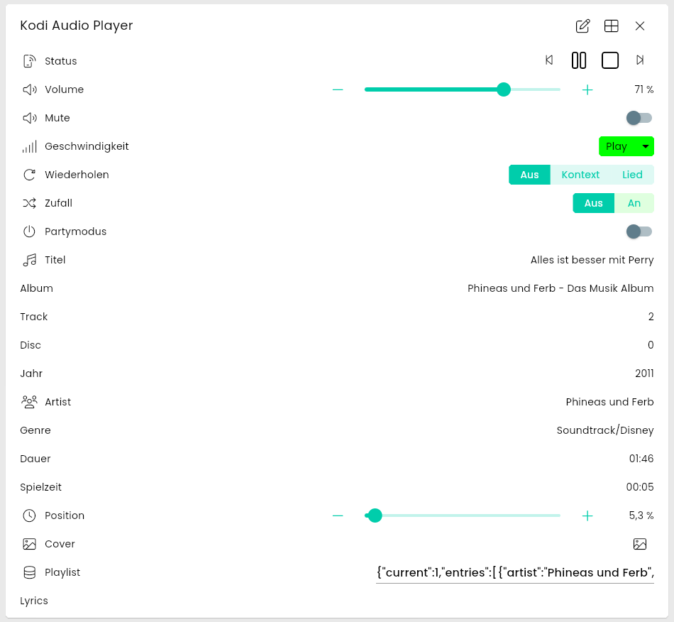  
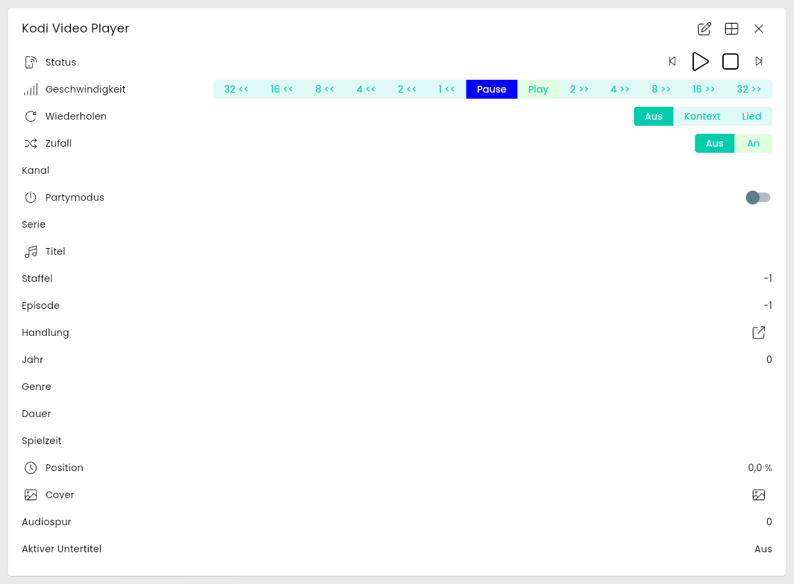  
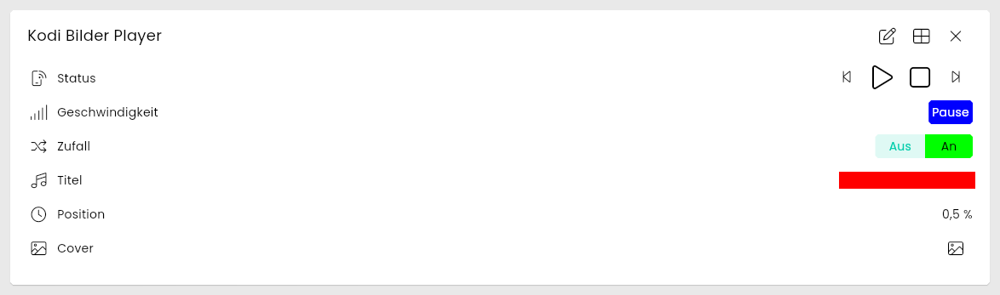  

> [!NOTE]
> Lautstärke und Stummschaltung gehören in Kodi zur Anwendung und liegen deshalb in der Instanz [Kodi Application](../KodiDeviceApplication/README.md). Die aktuelle Wiedergabeliste liegt in der Instanz [Kodi Playlist](../KodiDevicePlaylist/README.md). Die Mediaplayer-Kachel des Players zeigt diese Elemente daher nicht an.

> [!TIP]
> Eine Mediaplayer-Kachel mit allen Elementen lässt sich mit einer Instanz `Dummy Modul` erreichen. Darunter Links auf die Variablen `Status`, `Position`, `Wiederholen`, `Zufall`, `Titel` und `Artist` dieser Instanz anlegen, außerdem auf `Mute` und `Volume` der Instanz Kodi Application sowie auf die Variable `Playlist` (Profil `~Playlist`) der passenden Instanz Kodi Playlist.

### WebFront Visualisierung

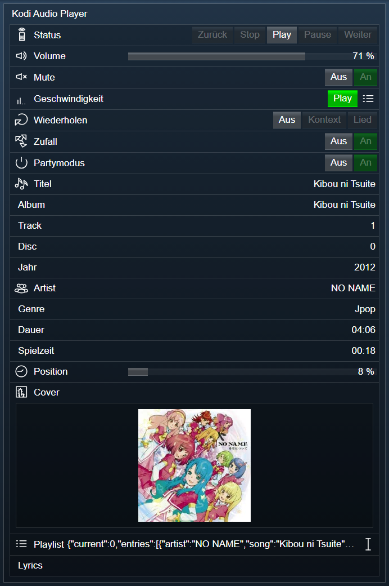  
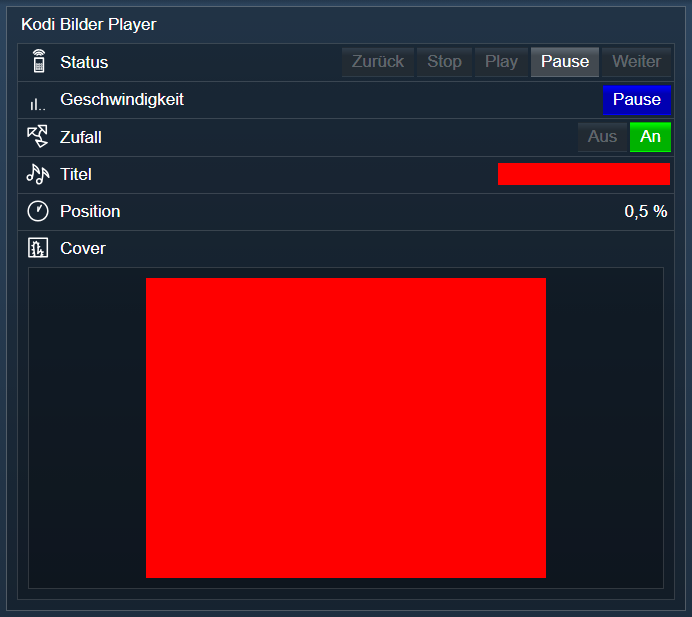  
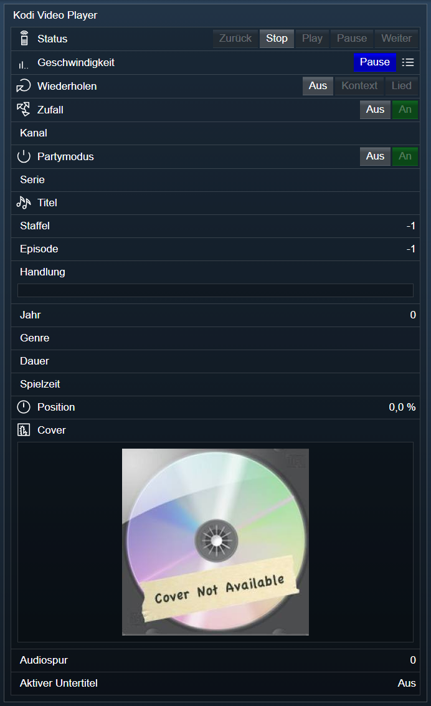

## 7. PHP-Befehlsreferenz

Für alle Befehle gilt:  
Tritt ein Fehler auf, wird eine Warnung erzeugt.

```php
array|bool KODIPLAYER_GetItem(integer $InstanzID);
```

Holt die Daten des aktuell wiedergegebenen Eintrags und gibt diese als assoziatives Array zurück.  
Liefert ein Array bei Erfolg, sonst `false`.

---

```php
bool KODIPLAYER_Play(integer $InstanzID);
bool KODIPLAYER_Pause(integer $InstanzID);
bool KODIPLAYER_Stop(integer $InstanzID);
```

Steuert die Wiedergabe.  
Liefert `true` bei Erfolg, sonst `false`.

---

```php
bool KODIPLAYER_GoToNext(integer $InstanzID);
bool KODIPLAYER_GoToPrevious(integer $InstanzID);
bool KODIPLAYER_GoToTrack(integer $InstanzID, integer $Value);
```

Springt zum nächsten, vorherigen oder einem bestimmten Titel in der Playlist.  
Liefert `true` bei Erfolg, sonst `false`.

---

```php
bool KODIPLAYER_SetPosition(integer $InstanzID, integer $Value);
```

Springt auf eine Position innerhalb der Wiedergabe.  

- `$Value`: Position in Prozent (0 bis 100).  
Liefert `true` bei Erfolg, sonst `false`.

---

```php
bool KODIPLAYER_SetSpeed(integer $InstanzID, integer $Value);
```

Setzt die Abspielgeschwindigkeit (`-32`, `-16`, `-8`, `-4`, `-2`, `0`, `1`, `2`, `4`, `8`, `16`, `32`).  
Liefert `true` bei Erfolg, sonst `false`.

---

```php
bool KODIPLAYER_SetRepeat(integer $InstanzID, integer $Value);
```

Setzt den Wiederholungsmodus (`0` = aus, `1` = Titel, `2` = Alle).  
Liefert `true` bei Erfolg, sonst `false`.

---

```php
bool KODIPLAYER_SetShuffle(integer $InstanzID, bool $Value);
```

De-/Aktiviert den Zufallsmodus.  
Liefert `true` bei Erfolg, sonst `false`.

---

```php
bool KODIPLAYER_SetPartymode(integer $InstanzID, bool $Value);
```

De-/Aktiviert den Partymodus.  
Liefert `true` bei Erfolg, sonst `false`.

---

```php
bool KODIPLAYER_SetAudioStream(integer $InstanzID, integer $Value);
```

Aktiviert die Audiospur mit dem übergebenen Index.  
Liefert `true` bei Erfolg, sonst `false`.

---

```php
bool KODIPLAYER_SetSubtitle(integer $InstanzID, integer $Value);
```

Aktiviert den Untertitel mit dem übergebenen Index. `-1` deaktiviert den Untertitel.  
Liefert `true` bei Erfolg, sonst `false`.

---

```php
bool KODIPLAYER_SetVideoStream(integer $InstanzID, integer $Value);
```

Wechselt die Videospur (nur bei Medien mit mehreren Videospuren).  

- `$Value`: Index der Videospur (Variable „Videospur“ bzw. KODIPLAYER_GetItem).

Rückgabe: True bei Erfolg, sonst false.  

---

```php
bool KODIPLAYER_AddSubtitle(integer $InstanzID, string $Subtitle);
```

Lädt eine zusätzliche Untertiteldatei zur aktuellen Wiedergabe.  

- `$Subtitle`: Lokaler Pfad (aus Sicht von Kodi) oder URL der Untertiteldatei.

Rückgabe: True bei Erfolg, sonst false.  

---

```php
bool KODIPLAYER_SetAudioDelay(integer $InstanzID, float $Value);
```

Setzt die Verzögerung des Tons zum Bild.  

- `$Value`: Verzögerung in Sekunden, Vielfache von 0,025. Standardbereich von Kodi -10 bis 10.

Rückgabe: True bei Erfolg, sonst false.  

---

```php
false|float KODIPLAYER_GetAudioDelay(integer $InstanzID);
```

Liest die aktuelle Verzögerung des Tons zum Bild.  

Rückgabe: Verzögerung in Sekunden oder false bei Fehler.  

---

```php
bool KODIPLAYER_SetViewMode(integer $InstanzID, string $Value);
```

Setzt das Bildformat der Videowiedergabe.  

- `$Value`: Bildformat: normal, zoom, stretch4x3, widezoom, stretch16x9, original, stretch16x9nonlin, zoom120width oder zoom110width.

Rückgabe: True bei Erfolg, sonst false.  

---

```php
false|array KODIPLAYER_GetViewMode(integer $InstanzID);
```

Liest das Bildformat und die Bildeinstellungen der Videowiedergabe.  

Rückgabe: Array mit viewmode, zoom, pixelratio, verticalshift und nonlinearstretch oder false bei Fehler.  

---

```php
bool KODIPLAYER_SetTempo(integer $InstanzID, float $Value);
```

Setzt das Wiedergabetempo mit Tonhöhenkorrektur.  

- `$Value`: Tempo, z.B. 1.0 für normal. Kodi bietet 0.8 bis 1.5 an.

Rückgabe: True bei Erfolg, sonst false.  

---

```php
bool KODIPLAYER_Zoom(integer $InstanzID, integer $Level);
```

Setzt die Zoomstufe des aktuellen Bildes (nur Bilder-Player).  

- `$Level`: Zoomstufe 1 (kein Zoom) bis 10.

Rückgabe: True bei Erfolg, sonst false.  

---

```php
bool KODIPLAYER_ZoomIn(integer $InstanzID);
```

Vergrößert das aktuelle Bild um eine Stufe (nur Bilder-Player).  

Rückgabe: True bei Erfolg, sonst false.  

---

```php
bool KODIPLAYER_ZoomOut(integer $InstanzID);
```

Verkleinert das aktuelle Bild um eine Stufe (nur Bilder-Player).  

Rückgabe: True bei Erfolg, sonst false.  

---

```php
bool KODIPLAYER_Rotate(integer $InstanzID, bool $Clockwise);
```

Dreht das aktuelle Bild um 90 Grad (nur Bilder-Player).  

- `$Clockwise`: True im Uhrzeigersinn, false gegen den Uhrzeigersinn.

Rückgabe: True bei Erfolg, sonst false.  

---

```php
bool KODIPLAYER_Move(integer $InstanzID, string $Direction);
```

Verschiebt den sichtbaren Ausschnitt des gezoomten Bildes (nur Bilder-Player).  

- `$Direction`: Richtung: 'left', 'right', 'up' oder 'down'.

Rückgabe: True bei Erfolg, sonst false.  

---

```php
false|array KODIPLAYER_GetPlayers(integer $InstanzID, string $Media);
```

Liefert alle Player von Kodi (intern, extern, UPnP-Renderer).  

- `$Media`: Filter: 'all', 'video' oder 'audio'.

Rückgabe: Array mit den Playern (name, type, playsvideo, playsaudio) oder false bei Fehler.  

---

```php
bool KODIPLAYER_LoadAlbum(integer $InstanzID, integer $AlbumId);
```

Lädt ein Album und startet die Wiedergabe.  

- `$AlbumId`: ID des Album.

Rückgabe: TRUE bei erfolgreicher Ausführung, sonst FALSE.  

---

```php
bool KODIPLAYER_LoadArtist(integer $InstanzID, integer $ArtistId);
```

Lädt alle Item eines Artist und startet die Wiedergabe.  

- `$ArtistId`: ID des Artist.

Rückgabe: TRUE bei erfolgreicher Ausführung, sonst FALSE.  

---

```php
bool KODIPLAYER_LoadChannel(integer $InstanzID, integer $ChannelId);
```

Lädt einen PVR-Kanal und startet die Wiedergabe.  

- `$ChannelId`: ID des Kanals.

Rückgabe: TRUE bei erfolgreicher Ausführung, sonst FALSE.  

---

```php
bool KODIPLAYER_LoadDirectory(integer $InstanzID, string $Directory);
```

Lädt alle Item eines Verzeichnisses und startet die Wiedergabe.  

- `$Directory`: Pfad welcher hinzugefügt werden soll.

Rückgabe: TRUE bei erfolgreicher Ausführung, sonst FALSE.  

---

```php
bool KODIPLAYER_LoadDirectoryRecursive(integer $InstanzID, string $Directory);
```

Lädt alle Item eines Verzeichnisses, sowie dessen Unterverzeichnisse, und startet die Wiedergabe.  

- `$Directory`: Pfad welcher hinzugefügt werden soll.

Rückgabe: TRUE bei erfolgreicher Ausführung, sonst FALSE.  

---

```php
bool KODIPLAYER_LoadEpisode(integer $InstanzID, integer $EpisodeId);
```

Lädt eine Episode und startet die Wiedergabe.  

- `$EpisodeId`: ID der Episode.

Rückgabe: TRUE bei erfolgreicher Ausführung, sonst FALSE.  

---

```php
bool KODIPLAYER_LoadFile(integer $InstanzID, string $File);
```

Lädt eine Datei und startet die Wiedergabe.  

- `$File`: Pfad zu einer Datei.

Rückgabe: TRUE bei erfolgreicher Ausführung, sonst FALSE.  

---

```php
bool KODIPLAYER_LoadGenre(integer $InstanzID, integer $GenreId);
```

Lädt eine komplettes Genre und startet die Wiedergabe.  

- `$GenreId`: ID des Genres.

Rückgabe: TRUE bei erfolgreicher Ausführung, sonst FALSE.  

---

```php
bool KODIPLAYER_LoadMovie(integer $InstanzID, integer $MovieId);
```

Lädt ein Film und startet die Wiedergabe.  

- `$MovieId`: ID des Filmes.

Rückgabe: TRUE bei erfolgreicher Ausführung, sonst FALSE.  

---

```php
bool KODIPLAYER_LoadMusicvideo(integer $InstanzID, integer $MusicvideoId);
```

Lädt ein Musikvideo und startet die Wiedergabe.  

- `$MusicvideoId`: ID des Musikvideos.

Rückgabe: TRUE bei erfolgreicher Ausführung, sonst FALSE.  

---

```php
bool KODIPLAYER_LoadPlaylist(integer $InstanzID);
```

Lädt die Playlist und startet die Wiedergabe.  

Rückgabe: TRUE bei erfolgreicher Ausführung, sonst FALSE.  

---

```php
bool KODIPLAYER_LoadRecording(integer $InstanzID, integer $RecordingId);
```

Lädt eine Aufzeichnung und startet die Wiedergabe.  

- `$RecordingId`: ID der Aufnahme.

Rückgabe: TRUE bei erfolgreicher Ausführung, sonst FALSE.  

---

```php
bool KODIPLAYER_LoadSong(integer $InstanzID, integer $SongId);
```

Lädt ein Songs und startet die Wiedergabe.  

- `$SongId`: ID des Songs.

Rückgabe: TRUE bei erfolgreicher Ausführung, sonst FALSE.  

---

```php
bool KODIPLAYER_LoadEx(integer $InstanzID, string $Type, string $Value, integer $Shuffle, integer $Repeat, bool $Resume);
```

Lädt ein Medium mit Optionen für Zufall, Wiederholung und Fortsetzen und startet die Wiedergabe.  

- `$Type`: Medientyp: Album, Artist, Genre, Song, Movie, Episode, Musicvideo, Channel, Recording, File, Directory, DirectoryRecursive oder Playlist.
- `$Value`: ID aus der Kodi-Datenbank oder Pfad. Bei Playlist die Startposition ab 1 (leer = Anfang).
- `$Shuffle`: Zufallswiedergabe: -1 = unverändert, 0 = aus, 1 = an.
- `$Repeat`: Wiederholung: -1 = unverändert, 0 = aus, 1 = Titel, 2 = Alle (wie SetRepeat).
- `$Resume`: True, um ab dem gespeicherten Fortsetzungspunkt zu starten.

Rückgabe: TRUE bei erfolgreicher Ausführung, sonst FALSE.  

---

```php
string|false KODIPLAYER_CreateTileLinks(integer $InstanzID);
```

Legt unterhalb der Player-Instanz Links auf `Volume` und `Mute` der Instanz Kodi Application sowie auf die Variable `Playlist` der passenden Instanz Kodi Playlist an, damit die Mediaplayer-Kachel alle Elemente zeigt. Gesucht wird nur bei Instanzen am selben Kodi-Splitter. Bereits vorhandene Links bleiben erhalten und erhalten das aktuelle Ziel.  
Die Funktion wird auch von der Schaltfläche `Links anlegen` im Formular aufgerufen.

Rückgabe: Meldung als Text bei Erfolg, sonst FALSE (z.B. wenn die Instanz keinen Splitter hat oder die Instanzen Application bzw. Playlist fehlen).

**Beispiel:**

```php
echo KODIPLAYER_CreateTileLinks(12345);
```

---

```php
string KODIPLAYER_RemoveTileLinks(integer $InstanzID);
```

Löscht die von `KODIPLAYER_CreateTileLinks` angelegten Links unterhalb der Player-Instanz. Die Ziele der Links bleiben unverändert.  
Die Funktion wird auch von der Schaltfläche `Links entfernen` im Formular aufgerufen.

Rückgabe: Meldung als Text.

**Beispiel:**

```php
echo KODIPLAYER_RemoveTileLinks(12345);
```

## 8. Aktionen

**Grundsätzlich können alle bedienbaren Statusvariablen als Ziel einer [`Aktion`](https://www.symcon.de/service/dokumentation/konzepte/automationen/ablaufplaene/aktionen/) mit `Auf Wert schalten` angesteuert werden, so dass hier keine speziellen Aktionen benutzt werden müssen.**

- Wiedergabe steuern über Buttons
- Position in der Wiedergabe anpassen
- Audiospur und Untertitel auswählen

## 9. Anhang

### 1. Changelog

[Changelog der Library](../README.md#2-changelog)

### 2. Spenden

Die Library ist für die nicht kommerzielle Nutzung kostenlos, Schenkungen als Unterstützung für den Autor werden hier akzeptiert:

PayPal:  
[](https://paypal.me/Nall4chan)

Wunschliste:  
[](https://www.amazon.de/hz/wishlist/ls/YU4AI9AQT9F?ref_=wl_share)

## 10. Lizenz

IPS-Modul:  
[Custom NC-SA](../LICENSE)