[](https://www.symcon.de/service/dokumentation/entwicklerbereich/sdk-tools/sdk-php/)
[](https://community.symcon.de/t/modul-kodi/41646)
[](https://www.symcon.de/de/service/dokumentation/installation/migrationen/v80-v81-q3-2025/)  
[](#10-lizenz)
[](https://github.com/Nall-chan/Kodi/actions)
[](https://github.com/Nall-chan/Kodi/actions)  
[](#2-spenden)
[](#2-spenden)
# Kodi Playlist (KodiDevicePlaylist)  <!-- omit in toc -->

Ermöglicht das Verwalten, Bearbeiten und Darstellen von Kodi-Wiedergabelisten in IP-Symcon.

## Inhaltsverzeichnis  <!-- omit in toc -->

- [1. Funktionsumfang](#1-funktionsumfang)
- [2. Voraussetzungen](#2-voraussetzungen)
- [3. Software-Installation](#3-software-installation)
- [4. Einrichten der Instanzen in IP-Symcon](#4-einrichten-der-instanzen-in-ip-symcon)
- [5. Statusvariablen](#5-statusvariablen)
- [6. Visualisierung](#6-visualisierung)
  - [Kachel Visualisierung](#kachel-visualisierung)
  - [WebFront Visualisierung](#webfront-visualisierung)
- [7. PHP-Befehlsreferenz](#7-php-befehlsreferenz)
- [8. Aktionen](#8-aktionen)
- [9. Anhang](#9-anhang)
  - [1. Changelog](#1-changelog)
  - [2. Spenden](#2-spenden)
- [10. Lizenz](#10-lizenz)

## 1. Funktionsumfang

- Anzeige und Verwaltung der Kodi-Wiedergabelisten.
- Hinzufügen, Einfügen, Tauschen und Entfernen von Einträgen.
- Leeren und Abfragen von Playlists.
- Visualisierung der Playlist-Inhalte im WebFront und in der Kachel-Visualisierung.

## 2. Voraussetzungen

- Symcon ab Version 9.0
- Verbundener [Kodi-Splitter](../KodiSplitter/README.md)
- Konfigurierter Playlist-Typ (Audio, Video oder Bilder)

## 3. Software-Installation

Dieses Modul ist Bestandteil der [Kodi-Library](../README.md#3-software-installation).

## 4. Einrichten der Instanzen in IP-Symcon

Eine einfache Einrichtung ist über den Konfigurator [Kodi Konfigurator](../KodiConfigurator/README.md) möglich.  
Bei der manuellen Einrichtung ist die Instanz im Dialog `Instanz hinzufügen` unter dem Hersteller `Kodi` zu finden.  

  

**Konfigurationsseite:**

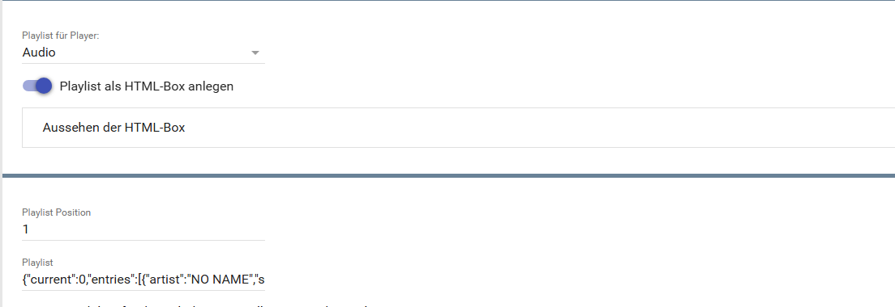  
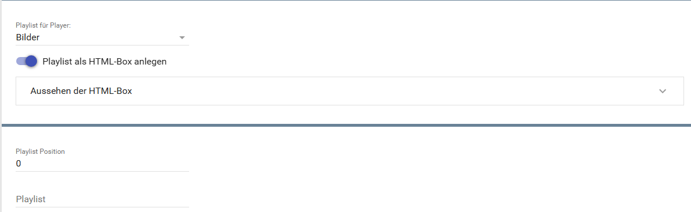  
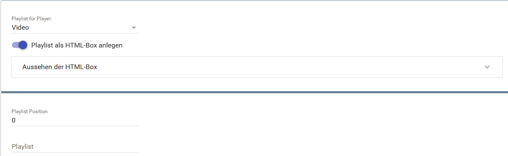  

| Eigenschaft           | Name                 |   Typ   | Standardwert | Beschreibung                           |
| :-------------------- | :------------------- | :-----: | :----------: | :------------------------------------- |
| Playlist Typ          | PlaylistID           | integer |      0       | 0 = Audio, 1 = Video, 2 = Bilder       |
| Zeige Playlist        | showPlaylist         | boolean |     true     | HTML-Tabelle mit der Playlist erzeugen |
| Aussehen der HTML-Box | Table, Columns, Rows | string  | siehe unten  | Design der HTML-Tabelle                |

**Aussehen der HTML-Box:**

Spalten, Farben und CSS der Playlist-Tabelle werden in drei Listen eingestellt. Die Listen liegen im Formular unter „Aussehen der HTML-Box“ und sind nur sichtbar, wenn die HTML-Box aktiviert ist.

| Liste   | Inhalt                                                                                                                                             |
| :------ | :------------------------------------------------------------------------------------------------------------------------------------------------- |
| Tabelle | CSS für die Tags `<table>`, `<thead>`, die Kopfzeile (`<thead><tr>`) und `<tbody>`                                                                 |
| Spalten | Je Datenfeld: sichtbar, Position, Überschrift, Breite (em), Ausrichtung, Textfarbe der Überschrift und zusätzliches CSS für Überschrift und Zellen |
| Zeilen  | Hintergrundfarbe, Textfarbe und zusätzliches CSS für gerade und ungerade Zeilen sowie für den aktuell gespielten Eintrag                           |

Die Eigenschaften `Table`, `Columns` und `Rows` sind JSON-Strings (Arrays der Listeneinträge) und können per `IPS_SetProperty` gesetzt werden. Einfacher ist das Bearbeiten im Formular.

> [!NOTE]
> Bis Version 3.02 wurde das Aussehen über ein verstecktes Konfigurations-Skript unterhalb der Instanz eingestellt. Beim Update wird dessen Inhalt einmalig in die Listen übernommen. Das Skript wird danach nicht mehr benutzt und kann gelöscht werden.

## 5. Statusvariablen

Folgende Statusvariablen werden automatisch angelegt. Je nach Konfiguration der Instanz werden einzelne Variablen nicht angelegt.

| Name              | Ident           |   Typ   | Beschreibung                                                        |
| :---------------- | :-------------- | :-----: | :------------------------------------------------------------------ |
| Playlist          | Playlist        | string  | HTML-Box mit den Einträgen der Playlist (Profil `~HTMLBox`)         |
| Playlist Position | position        | integer | Position des aktuellen Eintrags in der Playlist, schaltbar          |
| Playlist          | CurrentPlaylist | string  | Playlist für die Mediaplayer-Kachel (Profil `~Playlist`), schaltbar |

## 6. Visualisierung

### Kachel Visualisierung

Maximierte Kachel in der Darstellung `Liste` (Audio-, Video- und Bilder-Playlist). Die Playlist als HTML-Box erscheint in der Liste nur als Symbol zum Öffnen, deshalb ist sie zusätzlich geöffnet abgebildet (Audio und Video). Die Bilder-Playlist war beim Screenshot leer.  

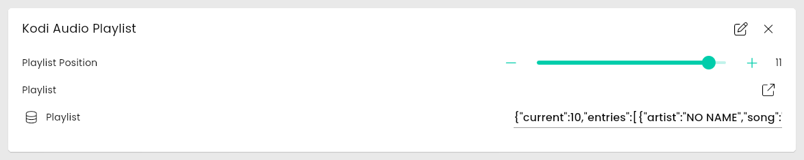  
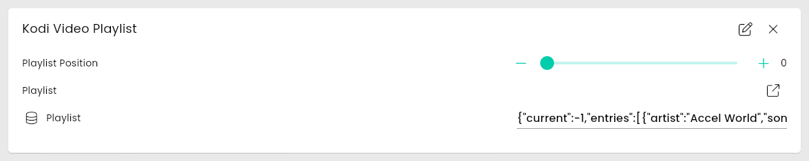  
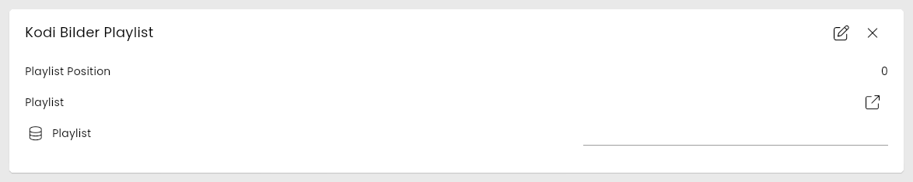  
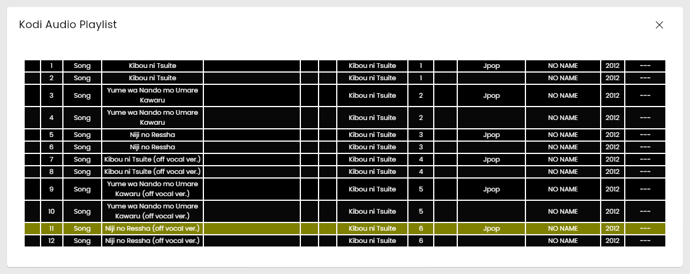  
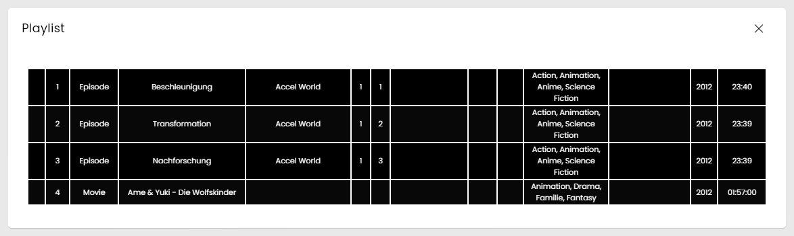  

### WebFront Visualisierung

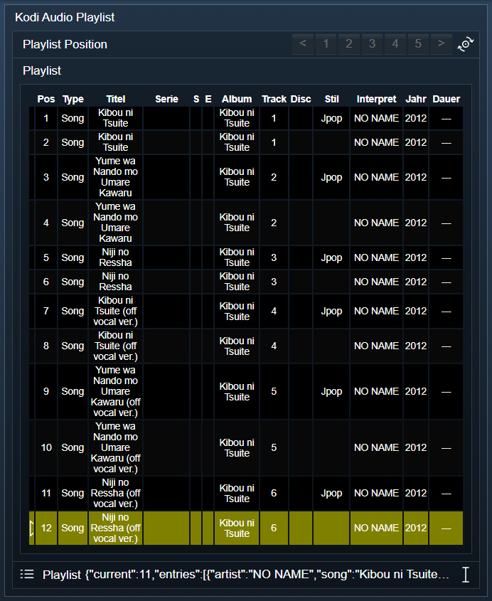  
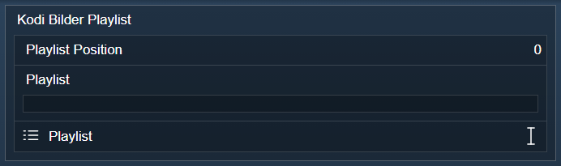  
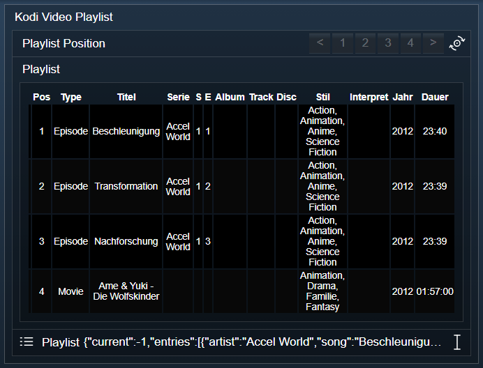

## 7. PHP-Befehlsreferenz

Für alle Befehle gilt:  
Tritt ein Fehler auf, wird eine Warnung erzeugt.  

> [!NOTE]
> Ein Mischen verschiedener Medienarten (Audio, Video, Bilder) in einer Playlist ist nicht möglich.

```php
bool KODIPLAYLIST_AddSong(integer $InstanzID, integer $SongId);
bool KODIPLAYLIST_AddAlbum(integer $InstanzID, integer $AlbumId);
bool KODIPLAYLIST_AddArtist(integer $InstanzID, integer $ArtistId);
bool KODIPLAYLIST_AddMovie(integer $InstanzID, integer $MovieId);
bool KODIPLAYLIST_AddEpisode(integer $InstanzID, integer $EpisodeId);
bool KODIPLAYLIST_AddMusicVideo(integer $InstanzID, integer $MusicvideoId);
bool KODIPLAYLIST_AddFile(integer $InstanzID, string $File);
bool KODIPLAYLIST_AddDirectory(integer $InstanzID, string $Directory);
bool KODIPLAYLIST_AddDirectoryRecursive(integer $InstanzID, string $Directory);
```

Fügt Einträge ans Ende der Playlist an.  
Liefert `true` bei Erfolg, sonst `false`.

---

```php
bool KODIPLAYLIST_InsertSong(integer $InstanzID, integer $SongId, integer $Position);
bool KODIPLAYLIST_InsertAlbum(integer $InstanzID, integer $AlbumId, integer $Position);
bool KODIPLAYLIST_InsertFile(integer $InstanzID, string $File, integer $Position);
```

Fügt Einträge an einer bestimmten Position in die Playlist ein.  
Liefert `true` bei Erfolg, sonst `false`.

---

```php
bool KODIPLAYLIST_Remove(integer $InstanzID, integer $Position);
```

Entfernt einen Eintrag an der angegebenen Position aus der Playlist.  
Liefert `true` bei Erfolg, sonst `false`.

---

```php
bool KODIPLAYLIST_Swap(integer $InstanzID, integer $Position1, integer $Position2);
```

Tauscht zwei Einträge innerhalb der Playlist.  
Liefert `true` bei Erfolg, sonst `false`.

---

```php
bool KODIPLAYLIST_Clear(integer $InstanzID);
```

Leert die gesamte Playlist.  
Liefert `true` bei Erfolg, sonst `false`.

---

```php
array|bool KODIPLAYLIST_Get(integer $InstanzID);
```

Gibt alle Einträge der Playlist als Array zurück.  
Liefert ein assoziatives Array bei Erfolg, sonst `false`.

---

```php
bool KODIPLAYLIST_GoTo(integer $InstanzID, integer $Index);
```

Springt zu einem Eintrag der Playlist und startet die Wiedergabe.  

- `$Index`: Position des Eintrags in der Playlist (beginnend bei 0).

Rückgabe: TRUE bei erfolgreicher Ausführung, sonst FALSE.  

---

```php
false|array KODIPLAYLIST_GetPlaylists(integer $InstanzID);
```

Gibt alle Playlisten von Kodi mit ihrer ID und ihrem Typ zurück.  

Rückgabe: Array mit den Playlisten (playlistid, type) oder false bei Fehler.  

---

```php
false|array KODIPLAYLIST_GetItem(integer $InstanzID, integer $Index);
```

Gibt ein Eintrag der Playlist zurück.  

- `$Index`: Index des Items welche gelesen werden soll.

Rückgabe: Das Array mit den Eigenschaften des Item, im Fehlerfall ein leeren Array.  

---

```php
bool KODIPLAYLIST_AddGenre(integer $InstanzID, integer $GenreId);
```

Fügt der Playlist eine komplettes Genre hinzu.  

- `$GenreId`: ID des Genres.

Rückgabe: TRUE bei erfolgreicher Ausführung, sonst FALSE.  

---

```php
bool KODIPLAYLIST_InsertArtist(integer $InstanzID, integer $ArtistId, integer $Position);
```

Fügt in der Playlist alle Items eines Artist ein.  
Alle anderen Einträge werden automatisch nach hinten verschoben.  

- `$ArtistId`: ID des Artist.
- `$Position`: Startposition des Album in der Playlist.

Rückgabe: TRUE bei erfolgreicher Ausführung, sonst FALSE.  

---

```php
bool KODIPLAYLIST_InsertDirectory(integer $InstanzID, string $Directory, integer $Position);
```

Fügt in der Playlist alle Item eines Verzeichnisses ein.  
Alle anderen Einträge werden automatisch nach hinten verschoben.  

- `$Directory`: Pfad welcher hinzugefügt werden soll.
- `$Position`: Startposition des Album in der Playlist.

Rückgabe: TRUE bei erfolgreicher Ausführung, sonst FALSE.  

---

```php
bool KODIPLAYLIST_InsertDirectoryRecursive(integer $InstanzID, string $Directory, integer $Position);
```

Fügt in der Playlist alle Item eines Verzeichnisses, sowie dessen Unterverzeichnisse, ein.  
Alle anderen Einträge werden automatisch nach hinten verschoben.  

- `$Directory`: Pfad welcher hinzugefügt werden soll.
- `$Position`: Startposition des Album in der Playlist.

Rückgabe: TRUE bei erfolgreicher Ausführung, sonst FALSE.  

---

```php
bool KODIPLAYLIST_InsertEpisode(integer $InstanzID, integer $EpisodeId, integer $Position);
```

Fügt in der Playlist eine Episode ein.  
Alle anderen Einträge werden automatisch nach hinten verschoben.  

- `$EpisodeId`: ID der Episode.
- `$Position`: Startposition des Album in der Playlist.

Rückgabe: TRUE bei erfolgreicher Ausführung, sonst FALSE.  

---

```php
bool KODIPLAYLIST_InsertGenre(integer $InstanzID, integer $GenreId, integer $Position);
```

Fügt in der Playlist eine komplettes Genre ein.  
Alle anderen Einträge werden automatisch nach hinten verschoben.  

- `$GenreId`: ID des Genres welches hinzugefügt werden soll.
- `$Position`: Startposition des Album in der Playlist.

Rückgabe: TRUE bei erfolgreicher Ausführung, sonst FALSE.  

---

```php
bool KODIPLAYLIST_InsertMovie(integer $InstanzID, integer $MovieId, integer $Position);
```

Fügt in der Playlist ein Filme ein.  
Alle anderen Einträge werden automatisch nach hinten verschoben.  

- `$MovieId`: ID des Filmes.
- `$Position`: Startposition des Album in der Playlist.

Rückgabe: TRUE bei erfolgreicher Ausführung, sonst FALSE.  

---

```php
bool KODIPLAYLIST_InsertMusicVideo(integer $InstanzID, integer $MusicvideoId, integer $Position);
```

Fügt in der Playlist ein Musicvideo ein.  
Alle anderen Einträge werden automatisch nach hinten verschoben.  

- `$MusicvideoId`: ID des Musikvideos.
- `$Position`: Startposition des Album in der Playlist.

Rückgabe: TRUE bei erfolgreicher Ausführung, sonst FALSE.  

## 8. Aktionen

**Grundsätzlich können alle bedienbaren Statusvariablen als Ziel einer [`Aktion`](https://www.symcon.de/service/dokumentation/konzepte/automationen/ablaufplaene/aktionen/) mit `Auf Wert schalten` angesteuert werden, so dass hier keine speziellen Aktionen benutzt werden müssen.**

- Playlist-Inhalte über Buttons verwalten
- Direktes Springen zu Einträgen
- Sortieren und Verändern der Playlist

## 9. Anhang

### 1. Changelog

[Changelog der Library](../README.md#2-changelog)

### 2. Spenden

Die Library ist für die nicht kommerzielle Nutzung kostenlos, Schenkungen als Unterstützung für den Autor werden hier akzeptiert:

PayPal:  
[](https://paypal.me/Nall4chan)

Wunschliste:  
[](https://www.amazon.de/hz/wishlist/ls/YU4AI9AQT9F?ref_=wl_share)

## 10. Lizenz

IPS-Modul:  
[Custom NC-SA](../LICENSE)