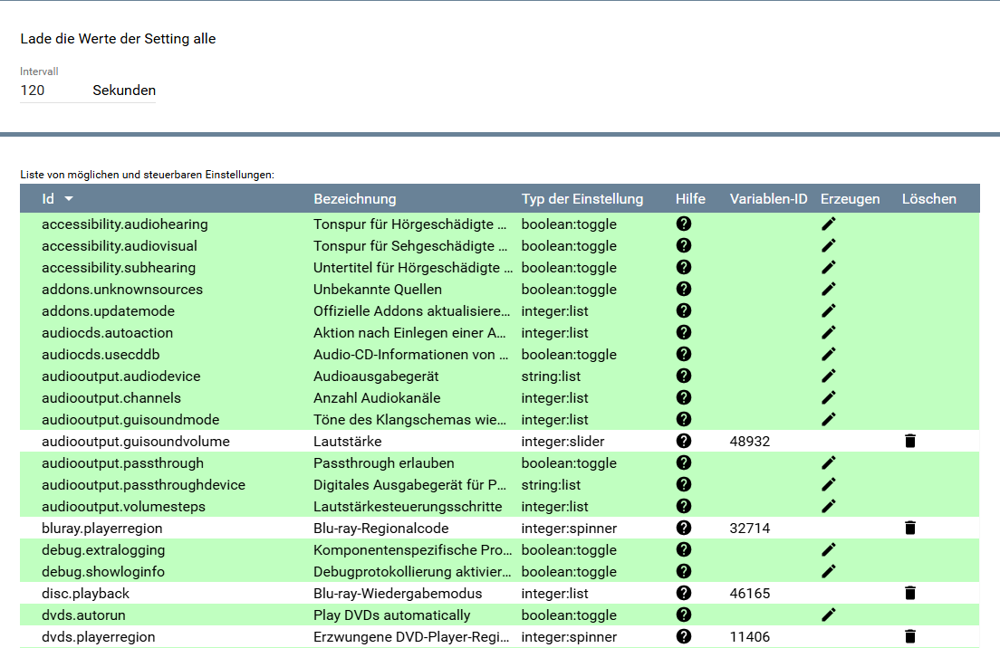
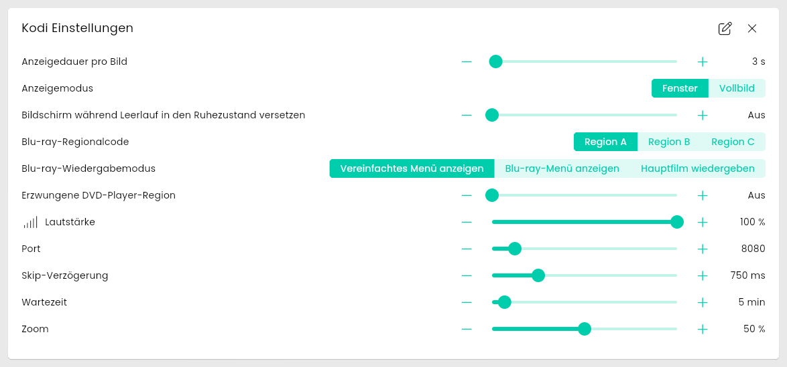
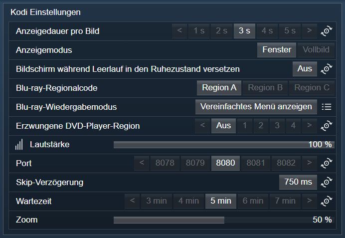

[](https://www.symcon.de/service/dokumentation/entwicklerbereich/sdk-tools/sdk-php/)
[](https://community.symcon.de/t/modul-kodi/41646)
[](https://www.symcon.de/de/service/dokumentation/installation/migrationen/v80-v81-q3-2025/)  
[](#10-lizenz)
[](https://github.com/Nall-chan/Kodi/actions)
[](https://github.com/Nall-chan/Kodi/actions)  
[](#2-spenden)
[](#2-spenden)
# Kodi Einstellungen (KodiDeviceSettings)  <!-- omit in toc -->

Ermöglicht das Auslesen, Ändern und Zurücksetzen von Kodi-Einstellungen in IP-Symcon.

## Inhaltsverzeichnis  <!-- omit in toc -->

- [1. Funktionsumfang](#1-funktionsumfang)
- [2. Voraussetzungen](#2-voraussetzungen)
- [3. Software-Installation](#3-software-installation)
- [4. Einrichten der Instanzen in IP-Symcon](#4-einrichten-der-instanzen-in-ip-symcon)
- [5. Statusvariablen](#5-statusvariablen)
- [6. Visualisierung](#6-visualisierung)
  - [Kachel Visualisierung](#kachel-visualisierung)
  - [WebFront Visualisierung](#webfront-visualisierung)
- [7. PHP-Befehlsreferenz](#7-php-befehlsreferenz)
- [8. Aktionen](#8-aktionen)
- [9. Anhang](#9-anhang)
  - [1. Changelog](#1-changelog)
  - [2. Spenden](#2-spenden)
- [10. Lizenz](#10-lizenz)

## 1. Funktionsumfang

- Lesen und Schreiben von Kodi-System- und Dienst-Einstellungen.
- Zurücksetzen von Einstellungen auf Werkseinstellungen.
- Anzeige von Einstellungen als Statusvariablen in IP-Symcon.

## 2. Voraussetzungen

- Symcon ab Version 9.0
- Verbundener [Kodi-Splitter](../KodiSplitter/README.md)

## 3. Software-Installation

Dieses Modul ist Bestandteil der [Kodi-Library](../README.md#3-software-installation).

## 4. Einrichten der Instanzen in IP-Symcon

Eine einfache Einrichtung ist über den Konfigurator [Kodi Konfigurator](../KodiConfigurator/README.md) möglich.  
Bei der manuellen Einrichtung ist die Instanz im Dialog `Instanz hinzufügen` unter dem Hersteller `Kodi` zu finden.  

  

**Konfigurationsseite:**



| Eigenschaft       | Name         |   Typ   | Standardwert | Beschreibung                            |
| :---------------- | :----------- | :-----: | :----------: | :-------------------------------------- |
| Abfrage-Intervall | RefreshState | integer |      60      | Intervall der Werte-Abfrage in Sekunden |

Beispiel:

```php
IPS_SetProperty(12345, 'RefreshState', 60);
IPS_ApplyChanges(12345);
```

**Liste der Einstellungen:**

Die Liste im Aktionsbereich zeigt alle von Kodi gemeldeten und von Symcon steuerbaren Einstellungen:

- Das Symbol in der Spalte `Hilfe` zeigt bei einem Klick die Hilfe von Kodi zu dieser Einstellung an (nur vorhanden, wenn Kodi einen Hilfetext liefert).
- Die Spalte `Variablen-ID` zeigt die ID der Statusvariable, sofern eine angelegt wurde.
- Das Stift-Symbol in der Spalte `Erzeugen` legt nach einer Rückfrage die Statusvariable zur Einstellung an. Es wird nur angezeigt, wenn noch keine Variable existiert und die Einstellung als Variable abbildbar ist.
- Das Mülleimer-Symbol in der Spalte `Löschen` löscht nach einer Rückfrage die Statusvariable der Einstellung wieder. Es wird nur angezeigt, wenn eine Variable existiert. Ein dazu angelegtes Profil wird mit entfernt.

## 5. Statusvariablen

Folgende Statusvariablen werden automatisch je nach ausgewählter Konfiguration angelegt.

| Name                     |  Typ  | Ident      | Beschreibung                               |
| :----------------------- | :---: | :--------- | :----------------------------------------- |
| Abgefragte Einstellungen | mixed | *Variiert* | Je nach konfigurierter Einstellung in Kodi |

## 6. Visualisierung

### Kachel Visualisierung

  

### WebFront Visualisierung



## 7. PHP-Befehlsreferenz

Für alle Befehle gilt:  
Tritt ein Fehler auf, wird eine Warnung erzeugt.

```php
array KODISETTINGS_GetSettings(integer $InstanzID);
```

Liefert alle Einstellungen als Array.

---

```php
bool|integer|string|array KODISETTINGS_GetSettingValue(integer $InstanzID, string $Setting);
```

Liefert den Wert der übergebenen Einstellung (z. B. `services.devicename`).

---

```php
bool KODISETTINGS_ResetSettingValue(integer $InstanzID, string $Setting);
```

Setzt eine Einstellung (z. B. `services.devicename`) auf Werkseinstellung zurück.  
Liefert `true` bei Erfolg, sonst `false`.

---

```php
bool KODISETTINGS_SetSettingValueBoolean(integer $InstanzID, string $Setting, bool $Value);
bool KODISETTINGS_SetSettingValueInteger(integer $InstanzID, string $Setting, integer $Value);
bool KODISETTINGS_SetSettingValueString(integer $InstanzID, string $Setting, string $Value);
```

Schreibt den Wert in die angegebene Einstellung (`$Setting`).  
Liefert `true` bei Erfolg, sonst `false`.

---

```php
bool KODISETTINGS_SetSettingValueFloat(integer $InstanzID, string $Setting, float $Value);
```

Setzt eine Einstellung vom Typ number (Kommazahl).  

- `$Setting`: Der Name der zu schreibenden Einstellung.
- `$Value`: Der Wert der zu schreibenden Einstellung.

Rückgabe: True bei Erfolg, false bei Fehler.  

---

```php
false|array KODISETTINGS_GetSkinSettings(integer $InstanzID);
```

Liefert den aktiven Skin und dessen Einstellungen.  

Rückgabe: Array mit 'skin' und 'settings' (id, type, value) oder false bei Fehler.  

---

```php
mixed KODISETTINGS_GetSkinSettingValue(integer $InstanzID, string $Setting);
```

Liefert den Wert einer Einstellung des aktiven Skins.  

- `$Setting`: Die Id der Skin-Einstellung (aus GetSkinSettings).

Rückgabe: Wert (bool oder string) oder NULL bei Fehler.  

---

```php
bool KODISETTINGS_SetSkinSettingValueBoolean(integer $InstanzID, string $Setting, bool $Value);
```

Setzt eine boolesche Einstellung des aktiven Skins.  

- `$Setting`: Die Id der Skin-Einstellung (aus GetSkinSettings).
- `$Value`: Der neue Wert.

Rückgabe: True bei Erfolg, false bei Fehler.  

---

```php
bool KODISETTINGS_SetSkinSettingValueString(integer $InstanzID, string $Setting, string $Value);
```

Setzt eine Text-Einstellung des aktiven Skins.  

- `$Setting`: Die Id der Skin-Einstellung (aus GetSkinSettings).
- `$Value`: Der neue Wert.

Rückgabe: True bei Erfolg, false bei Fehler.  

## 8. Aktionen

**Grundsätzlich können alle bedienbaren Statusvariablen als Ziel einer [`Aktion`](https://www.symcon.de/service/dokumentation/konzepte/automationen/ablaufplaene/aktionen/) mit `Auf Wert schalten` angesteuert werden, so dass hier keine speziellen Aktionen benutzt werden müssen.**

- Einstellungen über Variablen im WebFront/Kachel verändern

## 9. Anhang

### 1. Changelog

[Changelog der Library](../README.md#2-changelog)

### 2. Spenden

Die Library ist für die nicht kommerzielle Nutzung kostenlos, Schenkungen als Unterstützung für den Autor werden hier akzeptiert:

PayPal:  
[](https://paypal.me/Nall4chan)

Wunschliste:  
[](https://www.amazon.de/hz/wishlist/ls/YU4AI9AQT9F?ref_=wl_share)

## 10. Lizenz

IPS-Modul:  
[Custom NC-SA](../LICENSE)