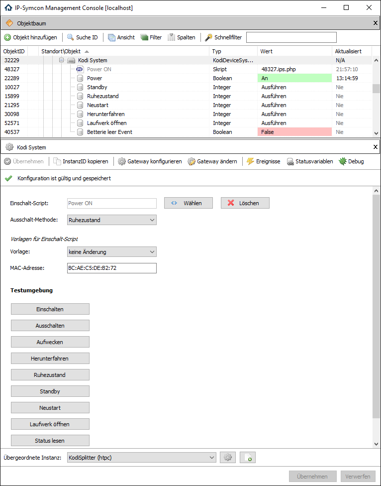

[](https://www.symcon.de/service/dokumentation/entwicklerbereich/sdk-tools/sdk-php/)
[](https://community.symcon.de/t/modul-kodi/41646)
[](https://www.symcon.de/de/service/dokumentation/installation/migrationen/v80-v81-q3-2025/)
[](#10-lizenz)
[](https://github.com/Nall-chan/Kodi/actions)
[](https://github.com/Nall-chan/Kodi/actions)
[](#2-spenden)
[](#2-spenden)

# Kodi System (KodiDeviceSystem)  <!-- omit in toc -->

Ermöglicht die Steuerung sowie die Darstellung von Systemzuständen (Ein/Aus, Neustart, Standby) und optischen Laufwerken von Kodi in IP-Symcon.

## Inhaltsverzeichnis  <!-- omit in toc -->

- [1. Funktionsumfang](#1-funktionsumfang)
- [2. Voraussetzungen](#2-voraussetzungen)
- [3. Software-Installation](#3-software-installation)
- [4. Einrichten der Instanzen in IP-Symcon](#4-einrichten-der-instanzen-in-ip-symcon)
- [5. Statusvariablen](#5-statusvariablen)
- [6. Visualisierung](#6-visualisierung)
  - [Kachel Visualisierung](#kachel-visualisierung)
  - [WebFront Visualisierung](#webfront-visualisierung)
- [7. PHP-Befehlsreferenz](#7-php-befehlsreferenz)
- [8. Aktionen](#8-aktionen)
- [9. Anhang](#9-anhang)
  - [1. Changelog](#1-changelog)
  - [2. Spenden](#2-spenden)
- [10. Lizenz](#10-lizenz)

## 1. Funktionsumfang

- Systemsteuerung (Ein/Aus, Neustart, Standby, Ruhezustand).
- Statusüberwachung der Systemfunktionen.
- Optisches Laufwerk auswerfen.
- Batterie-Status überwachen (falls vom System unterstützt).

## 2. Voraussetzungen

- Symcon ab Version 9.0
- Funktionierender KodiSplitter
- Konfigurierte Verbindung zu einem Kodi-Gerät

## 3. Software-Installation

Dieses Modul ist Bestandteil der [Kodi-Library](../README.md#3-software-installation).

## 4. Einrichten der Instanzen in IP-Symcon

Eine einfache Einrichtung ist über den Konfigurator [Kodi Konfigurator](../KodiConfigurator/README.md) möglich.  
Bei der manuellen Einrichtung ist die Instanz im Dialog `Instanz hinzufügen` unter dem Hersteller `Kodi` zu finden.

**Konfigurationsseite:**



| Name | Eigenschaft | Typ | Standardwert | Funktion |
| :--- | :--- | :---: | :--- | :--- |
| Einschalt-Typ | PowerOnType | int | 1 | 0 = internes WOL, 1 = WOLAction ausführen |
| MAC-Adresse | MACAddress | string | | MAC-Adresse für internes WOL |
| Einschalt-Aktion | WOLAction | string | | Aktion, welche zum Einschalten ausgeführt werden soll |
| Ausschalt-Methode | PowerOff | int | 0 | 0 = Herunterfahren, 1 = Ruhezustand, 2 = Standby |

## 5. Statusvariablen

Folgende Statusvariablen werden automatisch angelegt.

| Name | Typ | Ident | Beschreibung |
| :--- | :---: | :--- | :--- |
| Power | bool | Power | Power-Status (Ein / Aus) |
| Standby | bool | Standby | Standby-Status |
| Ruhezustand | bool | Hibernate | Ruhezustand-Status |
| Neustart | bool | Reboot | Neustart-Status |
| Niedriger Akkustand | bool | LowBattery | Event für niedrigen Akkustand |

## 6. Visualisierung

### Kachel Visualisierung

*Keine Kachel-Visualisierung vorhanden.*

### WebFront Visualisierung


## 7. PHP-Befehlsreferenz

Für alle Befehle gilt:  
Tritt ein Fehler auf, wird eine Warnung erzeugt.

```php
bool KODISYS_Power(int $InstanzID, bool $Value)
```

Schaltet Kodi ein (`true`) oder aus (`false`).  
Das Einschalten erfolgt per konfiguriertem WOL/Aktion, das Ausschalten nach der eingestellten Methode.  
Liefert `true` bei Erfolg, sonst `false`.

---

```php
bool KODISYS_WakeUp(int $InstanzID)
```

Führt die konfigurierte Einschalt-Aktion oder WOL aus, um die Hardware einzuschalten.  
Liefert `true` bei Erfolg, sonst `false`.

---

```php
bool KODISYS_Shutdown(int $InstanzID)
```

Führt ein Herunterfahren auf Betriebssystemebene aus.  
Liefert `true` bei Erfolg, sonst `false`.

---

```php
bool KODISYS_Hibernate(int $InstanzID)
```

Versetzt das System auf Betriebssystemebene in den Ruhezustand (Hibernate).  
Liefert `true` bei Erfolg, sonst `false`.

---

```php
bool KODISYS_Suspend(int $InstanzID)
```

Versetzt das System auf Betriebssystemebene in den Standby (Suspend).  
Liefert `true` bei Erfolg, sonst `false`.

---

```php
bool KODISYS_Reboot(int $InstanzID)
```

Führt einen Neustart auf Betriebssystemebene aus.  
Liefert `true` bei Erfolg, sonst `false`.

---

```php
bool KODISYS_EjectOpticalDrive(int $InstanzID)
```

Öffnet das optische Laufwerk.  
Liefert `true` bei Erfolg, sonst `false`.

---

```php
bool KODISYS_RequestState(int $InstanzID, string $Ident)
```

Fordert die Fähigkeiten/Zustände der Statusvariablen an.  
`$Ident` kann `canshutdown`, `canhibernate`, `cansuspend` oder `canreboot` sein.  
Liefert `true` bei Erfolg, sonst `false`.

## 8. Aktionen

**Grundsätzlich können alle bedienbaren Statusvariablen als Ziel einer [`Aktion`](https://www.symcon.de/service/dokumentation/konzepte/automationen/ablaufplaene/aktionen/) mit `Auf Wert schalten` angesteuert werden, so dass hier keine speziellen Aktionen benutzt werden müssen.**

- Systemzustand ändern über Buttons
- Optisches Laufwerk auswerfen

## 9. Anhang

### 1. Changelog

[Changelog der Library](../README.md#2-changelog)

### 2. Spenden

Die Library ist für die nicht kommerzielle Nutzung kostenlos, Schenkungen als Unterstützung für den Autor werden hier akzeptiert:

PayPal:  
[](https://paypal.me/Nall4chan)

Wunschliste:  
[](https://www.amazon.de/hz/wishlist/ls/YU4AI9AQT9F?ref_=wl_share)

## 10. Lizenz

IPS-Modul:  
[Custom NC-SA](../LICENSE)