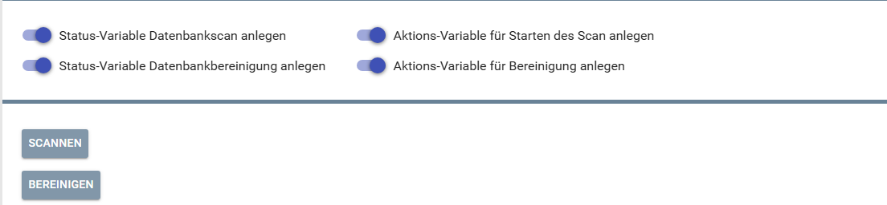
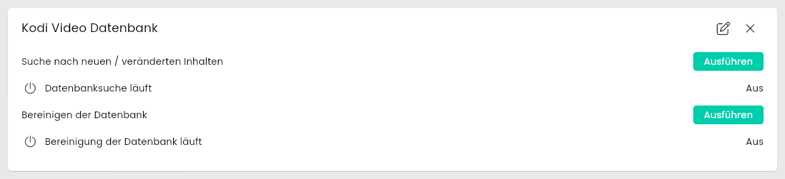
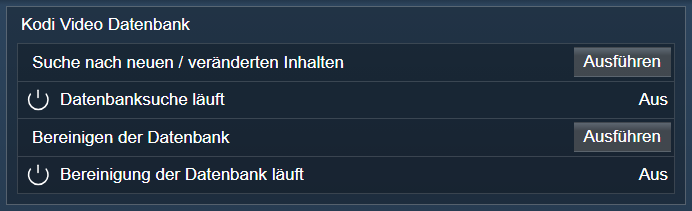

[](https://www.symcon.de/service/dokumentation/entwicklerbereich/sdk-tools/sdk-php/)
[](https://community.symcon.de/t/modul-kodi/41646)
[](https://www.symcon.de/de/service/dokumentation/installation/migrationen/v80-v81-q3-2025/)  
[](#10-lizenz)
[](https://github.com/Nall-chan/Kodi/actions)
[](https://github.com/Nall-chan/Kodi/actions)  
[](#2-spenden)
[](#2-spenden)
# Kodi Video Datenbank (KodiDeviceVideoLibrary)  <!-- omit in toc -->

Ermöglicht das Auslesen, Scannen, Bereinigen und Exportieren der Video-Datenbank von Kodi in IP-Symcon.

## Inhaltsverzeichnis  <!-- omit in toc -->

- [1. Funktionsumfang](#1-funktionsumfang)
- [2. Voraussetzungen](#2-voraussetzungen)
- [3. Software-Installation](#3-software-installation)
- [4. Einrichten der Instanzen in IP-Symcon](#4-einrichten-der-instanzen-in-ip-symcon)
- [5. Statusvariablen](#5-statusvariablen)
- [6. Visualisierung](#6-visualisierung)
  - [Kachel Visualisierung](#kachel-visualisierung)
  - [WebFront Visualisierung](#webfront-visualisierung)
- [7. PHP-Befehlsreferenz](#7-php-befehlsreferenz)
- [8. Aktionen](#8-aktionen)
- [9. Anhang](#9-anhang)
  - [1. Changelog](#1-changelog)
  - [2. Spenden](#2-spenden)
- [10. Lizenz](#10-lizenz)

## 1. Funktionsumfang

- Zugriff auf die Kodi-Video-Datenbank.
- Auslesen von Filmen, Serien, Episoden, Film-Sets und Musikvideos.
- Ausführen von Scannen und Bereinigen der Datenbank.
- Exportieren der Video-Datenbank.

## 2. Voraussetzungen

- Symcon ab Version 9.0
- Verbundener [Kodi-Splitter](../KodiSplitter/README.md)
- Eingerichtete Videobibliothek in Kodi

## 3. Software-Installation

Dieses Modul ist Bestandteil der [Kodi-Library](../README.md#3-software-installation).

## 4. Einrichten der Instanzen in IP-Symcon

Eine einfache Einrichtung ist über den Konfigurator [Kodi Konfigurator](../KodiConfigurator/README.md) möglich.  
Bei der manuellen Einrichtung ist die Instanz im Dialog `Instanz hinzufügen` unter dem Hersteller `Kodi` zu finden.  

  

**Konfigurationsseite:**



| Eigenschaft        | Name        |   Typ   | Standardwert | Beschreibung                                        |
| :----------------- | :---------- | :-----: | :----------: | :-------------------------------------------------- |
| Zeige Scan-Status  | showScan    | boolean |     true     | Statusvariable für DB-Scan anzeigen                 |
| Zeige Clean-Status | showClean   | boolean |     true     | Statusvariable für DB-Bereinigung anzeigen          |
| Zeige Scan-Aktion  | showDoScan  | boolean |     true     | Aktionsvariable zum Starten des Scans anlegen       |
| Zeige Clean-Aktion | showDoClean | boolean |     true     | Aktionsvariable zum Starten der Bereinigung anlegen |

Beispiel:

```php
IPS_SetProperty(12345, 'showScan', false);
IPS_ApplyChanges(12345);
```

## 5. Statusvariablen

Folgende Statusvariablen werden automatisch angelegt. Je nach Konfiguration der Instanz werden einzelne Variablen nicht angelegt.

| Name                                    | Ident   |   Typ   | Beschreibung                         |
| :-------------------------------------- | :------ | :-----: | :----------------------------------- |
| Suche nach neuen / veränderten Inhalten | doscan  | integer | Schaltfläche: Datenbanksuche starten |
| Datenbanksuche läuft                    | scan    | boolean | Datenbanksuche aktiv                 |
| Bereinigen der Datenbank                | doclean | integer | Schaltfläche: Datenbank bereinigen   |
| Bereinigung der Datenbank läuft         | clean   | boolean | Bereinigung aktiv                    |

## 6. Visualisierung

### Kachel Visualisierung

  

### WebFront Visualisierung



## 7. PHP-Befehlsreferenz

Für alle Befehle gilt:  
Tritt ein Fehler auf, wird eine Warnung erzeugt.

```php
bool KODIVIDEOLIB_Scan(integer $InstanzID);
```

Startet das Scannen der Video-Datenbank.  
Liefert `true` bei Erfolg, sonst `false`.

---

```php
bool KODIVIDEOLIB_Clean(integer $InstanzID);
```

Startet das Bereinigen der Video-Datenbank.  
Liefert `true` bei Erfolg, sonst `false`.

---

```php
bool KODIVIDEOLIB_Export(integer $InstanzID, string $Path, bool $Overwrite, bool $includeImages);
```

Exportiert die Video-Datenbank.  
Liefert `true` bei Erfolg, sonst `false`.

---

```php
array|bool KODIVIDEOLIB_GetMovieDetails(integer $InstanzID, integer $MovieId);
```

Liest die Eigenschaften eines Films aus.  
Liefert ein assoziatives Array bei Erfolg, sonst `false`.

---

```php
array|bool KODIVIDEOLIB_GetMovies(integer $InstanzID);
```

Liest alle Filme aus.  
Liefert ein Array bei Erfolg, sonst `false`.

---

```php
array|bool KODIVIDEOLIB_GetTVShowDetails(integer $InstanzID, integer $TvShowId);
```

Liest die Eigenschaften einer TV-Serie aus.  
Liefert ein assoziatives Array bei Erfolg, sonst `false`.

---

```php
array|bool KODIVIDEOLIB_GetTVShows(integer $InstanzID);
```

Liest alle TV-Serien aus.  
Liefert ein Array bei Erfolg, sonst `false`.

---

```php
array|bool KODIVIDEOLIB_GetEpisodeDetails(integer $InstanzID, integer $EpisodeId);
```

Liest die Eigenschaften einer Episode aus.  
Liefert ein assoziatives Array bei Erfolg, sonst `false`.

---

```php
array|bool KODIVIDEOLIB_GetEpisodes(integer $InstanzID);
```

Liest alle Episoden aus.  
Liefert ein Array bei Erfolg, sonst `false`.

---

```php
false|array KODIVIDEOLIB_GetEpisodesEx(integer $InstanzID, integer $Start, integer $Count);
```

Liest eine Seite der Episoden (für große Bibliotheken).  

- `$Start`: Erster Eintrag (ab 0).
- `$Count`: Anzahl der Einträge.

Rückgabe: Array mit 'total' (Gesamtzahl) und 'items' (Einträge) oder false bei Fehler.  

---

```php
false|array KODIVIDEOLIB_GetGenres(integer $InstanzID, string $Type);
```

Liest die Eigenschaften aller Genres aus.  
enum["movie"=Filme, "tvshow"=Serien, "musicvideo"=Musikvideos]  
* @return array | bool Array mit den Daten oder false bei Fehlern.  

- `$Type`: Der Typ der zu suchenden Genres.

---

```php
false|array KODIVIDEOLIB_GetInProgressTVShows(integer $InstanzID);
```

Liest die Eigenschaften aller angefangenen TV-Serien aus.  

Rückgabe: | bool Array mit den Daten oder false bei Fehlern.  

---

```php
false|array KODIVIDEOLIB_GetMoviesEx(integer $InstanzID, integer $Start, integer $Count);
```

Liest eine Seite der Filme (für große Bibliotheken).  

- `$Start`: Erster Eintrag (ab 0).
- `$Count`: Anzahl der Einträge.

Rückgabe: Array mit 'total' (Gesamtzahl) und 'items' (Einträge) oder false bei Fehler.  

---

```php
false|array KODIVIDEOLIB_GetMovieSetDetails(integer $InstanzID, integer $SetId);
```

Liest die Eigenschaften eines Film-Sets aus.  

- `$SetId`: SetId des zu lesenden Film-Sets.

Rückgabe: | bool Array mit den Daten oder false bei Fehlern.  

---

```php
false|array KODIVIDEOLIB_GetMovieSets(integer $InstanzID);
```

Liest die Eigenschaften aller Film-Sets.  

Rückgabe: | bool Array mit den Daten oder false bei Fehlern.  

---

```php
false|array KODIVIDEOLIB_GetMovieSetsEx(integer $InstanzID, integer $Start, integer $Count);
```

Liest eine Seite der Film-Sets (für große Bibliotheken).  

- `$Start`: Erster Eintrag (ab 0).
- `$Count`: Anzahl der Einträge.

Rückgabe: Array mit 'total' (Gesamtzahl) und 'items' (Einträge) oder false bei Fehler.  

---

```php
false|array KODIVIDEOLIB_GetMusicVideoDetails(integer $InstanzID, integer $MusicVideoId);
```

Liest die Eigenschaften eines Musikvideos aus.  

- `$MusicVideoId`: MusicVideoId des zu lesenden Musikvideos.

Rückgabe: | bool Array mit den Daten oder false bei Fehlern.  

---

```php
false|array KODIVIDEOLIB_GetMusicVideos(integer $InstanzID);
```

Liest die Eigenschaften aller Musikvideos.  

Rückgabe: | bool Array mit den Daten oder false bei Fehlern.  

---

```php
false|array KODIVIDEOLIB_GetMusicVideosEx(integer $InstanzID, integer $Start, integer $Count);
```

Liest eine Seite der Musikvideos (für große Bibliotheken).  

- `$Start`: Erster Eintrag (ab 0).
- `$Count`: Anzahl der Einträge.

Rückgabe: Array mit 'total' (Gesamtzahl) und 'items' (Einträge) oder false bei Fehler.  

---

```php
false|array KODIVIDEOLIB_GetRecentlyAddedEpisodes(integer $InstanzID);
```

Liest die Eigenschaften der zuletzt hinzugefügten Episoden aus.  

Rückgabe: | bool Array mit den Daten oder false bei Fehlern.  

---

```php
false|array KODIVIDEOLIB_GetRecentlyAddedMovies(integer $InstanzID);
```

Liest die Eigenschaften der zuletzt hinzugefügten Filme aus.  

Rückgabe: | bool Array mit den Daten oder false bei Fehlern.  

---

```php
false|array KODIVIDEOLIB_GetRecentlyAddedMusicVideos(integer $InstanzID);
```

Liest die Eigenschaften der zuletzt hinzugefügten Filme aus.  

Rückgabe: | bool Array mit den Daten oder false bei Fehlern.  

---

```php
false|array KODIVIDEOLIB_GetSeasonDetails(integer $InstanzID, integer $SeasonId);
```

Liest die Eigenschaften einer Staffel aus.  

- `$SeasonId`: SeasonId der zu lesenden Staffel (aus GetSeasons, nicht die Staffelnummer).

Rückgabe: | bool Array mit den Daten oder false bei Fehlern.  

---

```php
false|array KODIVIDEOLIB_GetSeasons(integer $InstanzID, integer $TvShowId);
```

Liest die Eigenschaften aller Staffeln einer TV-Serie aus.  

- `$TvShowId`: TvShowId der zu lesenden Serie.

Rückgabe: | bool Array mit den Daten oder false bei Fehlern.  

---

```php
false|array KODIVIDEOLIB_GetTags(integer $InstanzID, string $Type);
```

Liest alle Tags eines Medientyps aus.  
enum["movie"=Filme, "tvshow"=Serien, "musicvideo"=Musikvideos]  

- `$Type`: Der Typ der Medien.

Rückgabe: | bool Array mit den Daten oder false bei Fehlern.  

---

```php
false|array KODIVIDEOLIB_GetTVShowsEx(integer $InstanzID, integer $Start, integer $Count);
```

Liest eine Seite der TV-Serien (für große Bibliotheken).  

- `$Start`: Erster Eintrag (ab 0).
- `$Count`: Anzahl der Einträge.

Rückgabe: Array mit 'total' (Gesamtzahl) und 'items' (Einträge) oder false bei Fehler.  

## 8. Aktionen

**Grundsätzlich können alle bedienbaren Statusvariablen als Ziel einer [`Aktion`](https://www.symcon.de/service/dokumentation/konzepte/automationen/ablaufplaene/aktionen/) mit `Auf Wert schalten` angesteuert werden, so dass hier keine speziellen Aktionen benutzt werden müssen.**

- Scan und Clean über Buttons startbar
- Export über PHP-Befehl möglich

## 9. Anhang

### 1. Changelog

[Changelog der Library](../README.md#2-changelog)

### 2. Spenden

Die Library ist für die nicht kommerzielle Nutzung kostenlos, Schenkungen als Unterstützung für den Autor werden hier akzeptiert:

PayPal:  
[](https://paypal.me/Nall4chan)

Wunschliste:  
[](https://www.amazon.de/hz/wishlist/ls/YU4AI9AQT9F?ref_=wl_share)

## 10. Lizenz

IPS-Modul:  
[Custom NC-SA](../LICENSE)